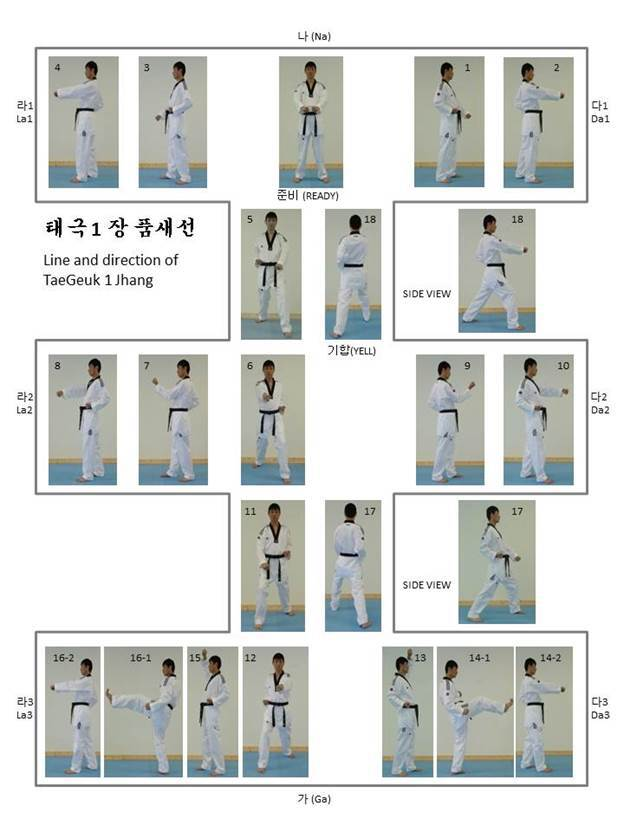
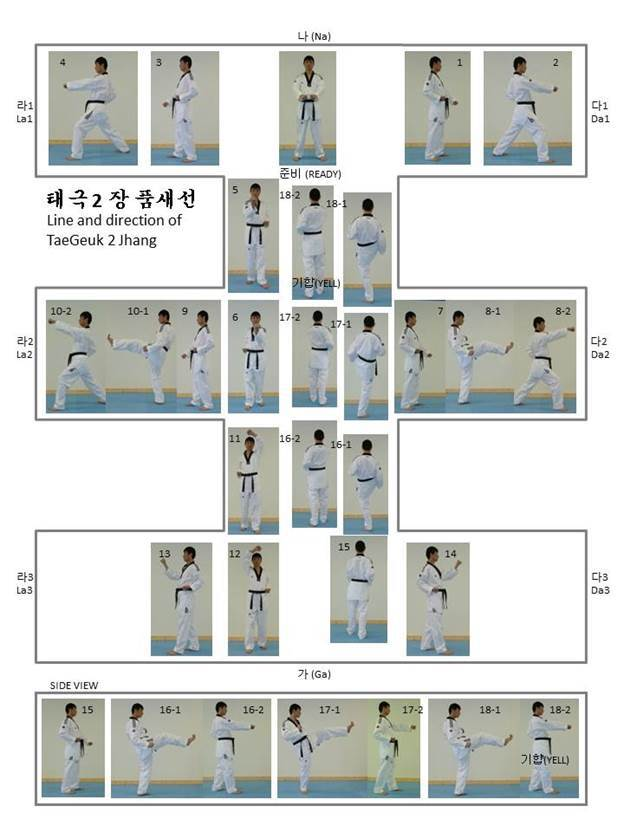
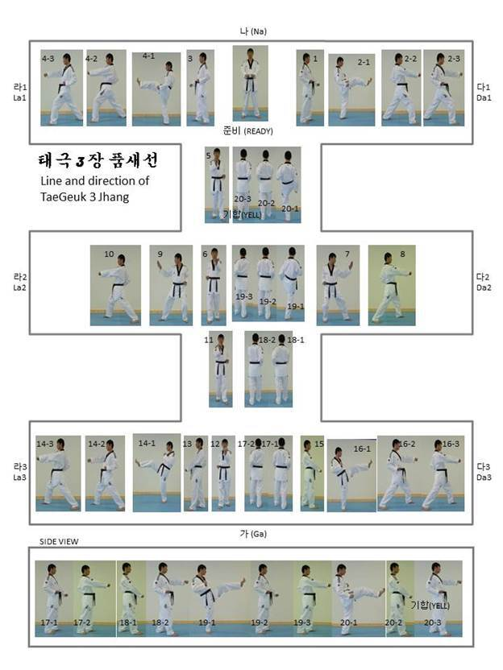
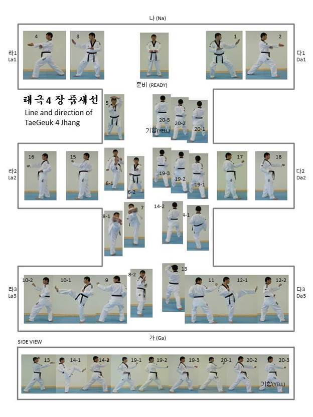
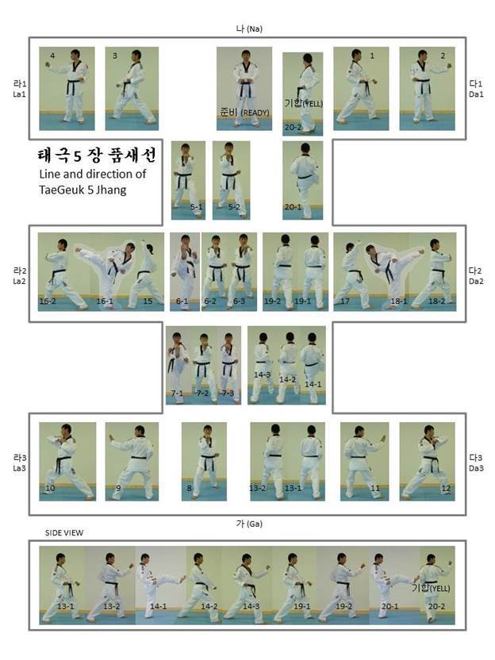
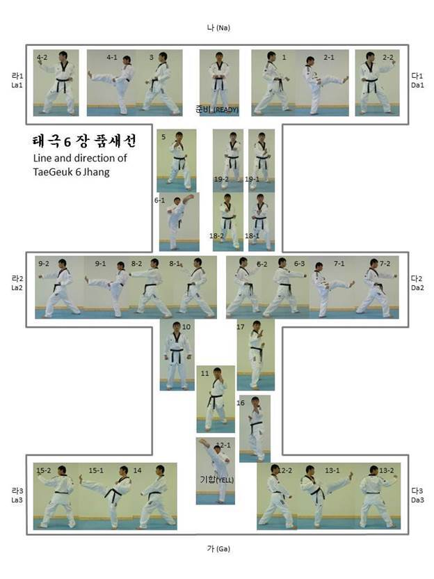
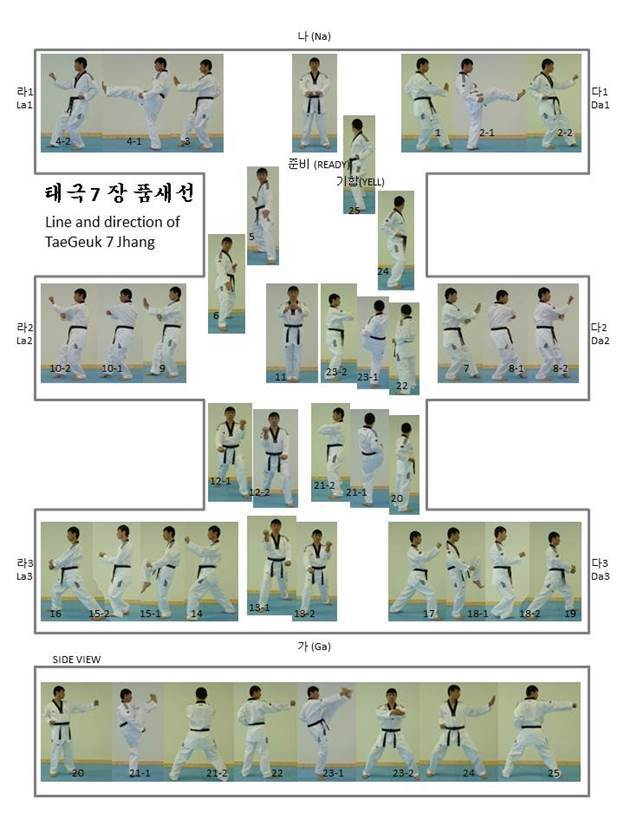
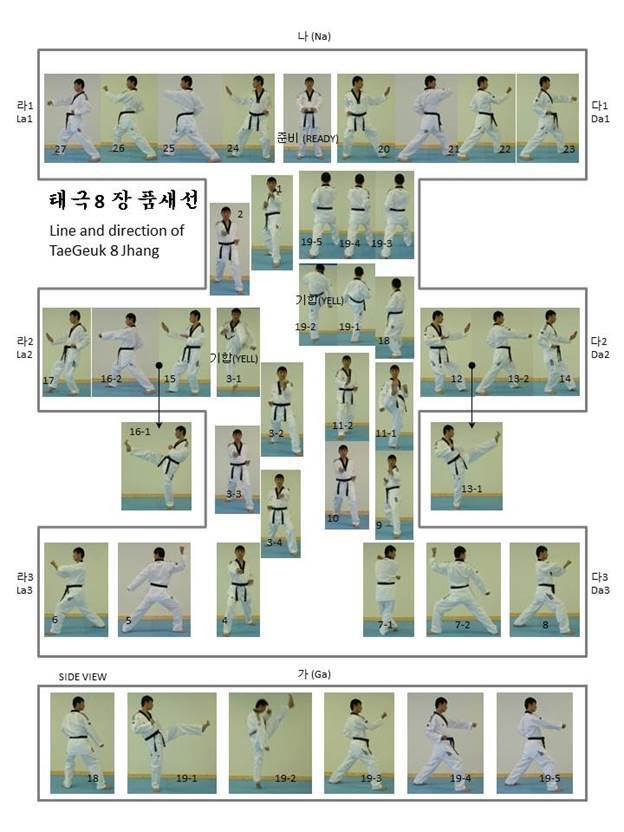

# Taekwondo: verstehen, üben und reflektieren

Eigenständige thematische Referenz zum erweiterten Kurs. Lies einen Gedanken, wähle eine bekannte Bewegung und nimm eine Frage mit zum Unterricht. Dies ist eine eigenständige didaktische Synthese, keine Übersetzung der bereitgestellten Bücher, kein vollständiger Lehrplan höherer Grade und kein Nachweis der Prüfungsreife.

Sprachen: [English](course-reference.en.md) · [Español](course-reference.es.md) · **Deutsch**.

## Inhaltsverzeichnis

- [Umfang und sichere Nutzung](#scope)
- [Bewegungsgrundlagen](#movement)
- [Eine Technik verstehen](#technique-purpose)
- [Blocks: Richtung, Fläche und Unterstützung](#blocks)
- [Grundsätze als praktisches Verhalten](#principles)
- [Technikreferenz: 37 kanonische Einträge](#techniques)
- [Formen und unterschiedliche Traditionen](#patterns)
- [Acht Taegeuk-Referenzen und genehmigte Bildtafeln](#taegeuk)
- [Geschichte: Überlieferung und Belege](#history)
- [Freiwillige Meditation](#meditation)
- [Aufwärmen](#warmup)
- [Aktive Mobilität](#mobility)
- [Sanftes Dehnen](#stretching)
- [Konditionstraining und Erholung](#conditioning)
- [Übungsplanung](#practice)
- [Lehrplan, Prüfungen und Lehrkraft](#curriculum)
- [Quellen und Grenzen](#sources)

## Umfang und sichere Nutzung

Das Handbuch behandelt die zehn aktuellen Konzeptthemen, 29 erweiterte Anfängertechniken und acht ausgewählte Technikeinträge höherer Stufen, den Formenkontext, Geschichte und acht ergänzende Fototafeln. Andere fortgeschrittene Kombinationen, Kontaktübungen, Bruchtests und Selbstverteidigungsanwendungen werden hier nicht unabhängig bestätigt. Das Vereinsprogramm bestimmt Anforderungen; Bücher liefern Kontext, keine Ersatzregeln.

Übe nur bekannte Bewegungen auf freier, rutschfester Fläche. Beginne langsam, mit angenehmem Bewegungsumfang, normaler durchgehender Atmung und kontrollierten Gelenken. Höre bei Schmerzen, Schwindel, ungewöhnlicher Atemnot, Gelenkbeschwerden oder Gleichgewichtsverlust auf; auch Kribbeln und Taubheit bedeuten Stopp. Ruhe dich bis zum Wohlbefinden aus; wiederhole nicht bei nachlassender Kontrolle. Anhaltende oder beunruhigende Symptome brauchen qualifizierte gesundheitliche Abklärung. Ein Text kann weder Beschwerden für harmlos erklären noch Rehabilitation verordnen.

Üben im Sitzen, fester Halt, kleinere Drehungen, niedrigere Kicks, geringerer Umfang, gedankliches Durchgehen oder Ruhe sind gültige Alternativen. Bitte um individuelle Anpassungen, wenn Erkrankung, Verletzung oder Unsicherheit eine Übung ungeeignet machen. Erzwinge weder Atmung noch Bewegungsumfang. Keine Technik, Dehnung oder Meditation garantiert Gesundheit, Verletzungsfreiheit, Waffenschutz oder Verteidigungserfolg. Partner- und Pratzentraining brauchen qualifizierte Aufsicht, geeignete Ausrüstung und vereinbarte Intensität; dieses Handbuch enthält keine Partnerkontakt-Rezepte oder Übungen an verletzlichen Zielen.

## Bewegungsgrundlagen

Eine Stellung ist eine Bewegungsgrundlage, keine Haltung zum Ausharren. Gleichgewicht bedeutet, Gewicht zu verlagern, zu drehen und in Bereitschaft zurückzukehren, ohne die Kontrolle zu verlieren. Tiefer oder breiter ist nicht automatisch besser. Das Knie folgt grundsätzlich der Fußrichtung; lass den Standfuß mitdrehen, statt das Knie über einem feststehenden Fuß zu verdrehen.

Trenne zunächst die Aufgaben: Übe einen kleinen Schritt, ergänze eine bekannte Armbewegung und prüfe, ob Füße und Hände wie unterrichtet gemeinsam enden. Wird die Kombination instabil, verkleinere die Drehung oder lasse die Arme weg. Einige langsame Gewichtsverlagerungen mit beiden Füßen am Boden zeigen mehr als eine schnelle Folge, die Wackeln verdeckt.

Entspannung entfernt unnötige Spannung, ohne den nötigen Halt aufzugeben. Achte auf hochgezogene Schultern, festen Kiefer oder stockende Atmung. Komm zur Ruhe, atme normal und setze nur bei Wohlbefinden fort. Die Vereinsausführung hat Vorrang vor festen Buchmaßen; Körperproportionen und Beweglichkeit unterscheiden sich.

## Eine Technik verstehen

Nutze sechs Fragen: **Zweck → Vorbereitung → Bewegung → häufiger Fehler → kontrollierter Abschluss → Rückkehr**. Eine Ausholposition schafft einen wiederholbaren Ausgangspunkt für den Bewegungsweg. Die Endhaltung erleichtert der Lehrkraft die Ausrichtungskontrolle; Übergang und Rückkehr gehören aber ebenso zur Technik.

Genauigkeit, Timing, Geschwindigkeit und Kraft sind verschiedene Eigenschaften. Mehr Tempo kann einen instabilen Stand verdecken; mehr Kraft kann einen ungünstigen Weg festigen. Beobachte bei Soloübungen in der Luft ein Merkmal, etwa die Handgelenkausrichtung oder das ausbalancierte Absetzen, statt alles zugleich zu korrigieren. Stoppe vor dem Verriegeln von Ellenbogen oder Knie.

Formale Grundschule, Formen und sportlicher Freikampf haben unterschiedliche Bedingungen. Ein Fauststoß von der Hüfte ist ein Grundübungsmodell, keine Regel, dass jeder freie Stoß dort beginnen muss. Beende ebenso eine Formenbewegung kontrolliert, bevor du die nächste vorbereitest: Rückkehr heißt nicht, jeden Block wegzuschnappen, bevor die Stellung steht. Alleinige Wiederholung vermittelt nicht sämtliche Entscheidungen über fremde Distanz oder Timing.

## Blocks: Richtung, Fläche und Unterstützung

Ein Block kontrolliert eine ankommende Linie, oft durch Umlenken statt frontalen Zusammenstoß. Position, Abstand, Timing und Wegbewegen zählen ebenso wie die Armhaltung. Einen Namen zu kennen macht die Ausführung in einer unvorhersehbaren Begegnung nicht zuverlässig.

| Unabhängiges Merkmal | Bedeutung |
| --- | --- |
| Höhe | Arae, momtong und olgul unterscheiden tiefe, mittlere und hohe Bereiche. |
| Richtung | An und packat bezeichnen im Vereinswortschatz Wege nach innen/außen, keine weiteren Höhen. Frage nach dem Bezugspunkt. |
| Fläche | Palmok und sonnal benennen Unterarm oder Handkante; Innen-/Außenunterarm bedeutet nicht automatisch eine Bewegung nach innen/außen. |
| Zweite Hand | Einzelblock, beidhändige Deckungsform und verstärkter Block geben der zweiten Hand unterschiedliche Aufgaben. |

Bei `sonnal-momtong-kotoro-macki` deckt die hintere Hand vor dem Rumpf; sie drückt nicht auf das vordere Handgelenk. Bei `goduro-packat-palmok-packat-macki` nimmt die zweite Faust die vorgesehene Stützposition ein; presse sie nicht ins Handgelenk. Verstärkung macht einen Aufprall nicht sicher. Kreuz- und Scherenblock unterscheiden sich ebenfalls: Einer kreuzt die Handgelenke auf tiefer Linie, der andere trennt die Arme auf zwei Höhen.

Zeichne einen bereits unterrichteten Block langsam in der Luft nach und beachte beide Arme, Stellung und Rückkehr. Verkleinere den Weg, wenn eine Schulter hochzieht oder das Gleichgewicht verloren geht. Schlage keine Unterarme zusammen und fordere keine Treffer zum Testen an. Ähnliche Quellbegriffe beweisen keine identische Mechanik verschiedener Organisationen.

## Grundsätze als praktisches Verhalten

- **Höflichkeit:** Lass Platz, höre zu und respektiere die Entscheidung, nicht mitzumachen.
- **Integrität:** Gib Unsicherheit zu und beschreibe tatsächlich Geübtes statt gewünschter Beherrschung.
- **Ausdauer:** Kehre nach Ruhe und Rückmeldung zu einem schwierigen Übergang zurück, nicht durch eine Verletzung hindurch.
- **Selbstkontrolle:** Senke die Intensität und beachte ein Stoppsignal sofort.
- **Unbezwingbarer Geist:** Sprich Bedenken an, lehne unsichere Forderungen ab und bitte bei Bedarf um Anpassung.

Wähle für die nächste Stunde ein beobachtbares Verhalten und reflektiere danach. Diese fünf Grundsätze sind ein hilfreicher ethischer Rahmen, kein Beweis moralischer Überlegenheit durch Rang und kein unveränderter antiker Kodex. Nervosität und Ruhebedarf sind keine Charakterfehler.

## Technikreferenz: 37 kanonische Einträge

Die IDs bewahren die Vereinsbegriffe der App, einschließlich Schreibweisen wie macki, chirugi und düt. Ordne unbekannte Namen anhand von Weg, Fläche, Stellung und Tradition zu, nicht nur nach Klang. Ein Programmname kann eine Höhe mit verletzlicher Anatomie benennen; er erlaubt dort niemals Kontakt. Alle Beschreibungen unterliegen den obigen Sicherheitsgrenzen. Polsterhinweise bedeuten angeleitetes Training, keine Partnerübung für zu Hause.

### Stellungen und Bereitschaft

#### `moa-sogi` — Achtungsstellung des Vereins
Für Gruß sowie Beginn oder Ende der Übung Fersen zusammenbringen, Zehen leicht öffnen und Arme neben dem Körper halten. Aufrecht stehen, ohne starre Knie oder hochgezogene Schultern. Normal atmen, Gleichgewicht finden und ruhig in die nächste Stellung treten. Dies ist Vereinskonvention, keine allgemeine Definition einer geschlossenen Stellung.

#### `pyonhi-sogi` — bequeme Parallelstellung
Sie dient als bewegliche Bereitschaft zwischen Techniken. Füße etwa schulterbreit setzen, Gewicht gleich verteilen und Rumpf aufrecht halten. Starre Knie und ausschließlichen Zehenstand vermeiden. Schultern entspannen und ohne vorbereitendes Wippen in die nächste Aktion wechseln.

#### `chuchum-sogi` — Pferdestellung
Die breite Basis unterstützt Grundschul-Fauststöße und Beinkontrolle. In einen angenehm breiten Parallelstand treten, Knie in Fußrichtung beugen und Gewicht gleich verteilen. Weder Breite noch Tiefe erzwingen; Knie nicht nach innen fallen lassen. Aufrecht mit getragenen Füßen abschließen und dann ruhig aufrichten oder weitergehen.

#### `ap-sogi` — kurze Schrittstellung
Für bewegliche Übergänge einen natürlichen kurzen Schritt mit etwas seitlichem Fußabstand machen. Vorderes Knie locker und Rumpf aufrecht halten. Eine Seiltänzerlinie oder übertrieben lange Stellung vermeiden. Ohne Wippen ankommen und das Gewicht ruhig in die nächste Bewegung übertragen.

#### `ap-gubi` — lange Vorwärtsstellung
Für Blocks und Fauststöße eine stabile Basis auf zwei getrennten Fußspuren aufbauen. Vorderes Knie in Fußrichtung beugen, hinteres Bein ohne Verriegeln strecken und hintere Ferse am Boden lassen. Weder Tiefe erzwingen noch über das Knie lehnen. Stellung und Hände gemeinsam abschließen, dann Gewicht ruhig verlagern.

#### `düt-gubi` — Rückwärts- oder L-Stellung
Der Vorderfuß bleibt für Schritt oder Tritt leicht. Füße in L-Anordnung setzen, beide Knie beugen und den Großteil des Gewichts über dem hinteren Bein halten. Rumpf aufrecht und beide Füße getragen lassen. Nicht zurücklehnen oder Knie gegen die Fußrichtung zwingen; ohne vorbereitendes Schwanken weitergehen.

#### `gibon-junbi-sogi` — Grund-Bereitschaftsstellung
Für den Beginn vieler Formen Füße parallel setzen und beide Fäuste in die vorgesehene gerundete Position auf Gürtelknotenhöhe bringen. Gewicht ausgleichen, Ellenbogen locker und Schultern tief halten. Verkrampfte Schultern und angehaltenen Atem vermeiden. Vor dem Beginn ruhig stehen und ohne zusätzliches Wippen starten.

#### `narani-sogi` — vereinsübliche Parallel-Außenkantenstellung
Im Verein zeigen die Zehen leicht nach innen, sodass die Fußaußenkanten parallel sind. Kukkiwon narani seogi verwendet dagegen Zehen nach vorn: Konventionen nicht stillschweigend austauschen. Füße setzen, ohne Knie nach innen zu zwingen, Gewicht ausgleichen und Schultern entspannen. Aufrecht und normal atmend bewegungsbereit abschließen; bei unangenehmer Stellung nachfragen.

#### `bom-sogi` — Tigerstellung; ausgewählter höherer Eintrag
Der leichte Vorderfuß erleichtert den Übergang zu Schritt oder Tritt. Beide Knie beugen, Gewicht hauptsächlich hinten absetzen und vorn den Ballen mit nur leicht angehobener Ferse aufsetzen. Rumpf aufrecht und Knie in Fußrichtung halten. Keine Fersenhöhe erzwingen oder zurücklehnen; Gleichgewicht finden und ohne vorheriges Wippen starten.

### Fauststöße und Handtechniken

#### `momtong-chirugi` — gerader Mittelstoß der Grundschule
Aus stabilem Stand die Faust an der Hüfte vorbereiten und geradlinig vorführen; Hüftdrehung und zurückziehende Hand abstimmen. Die ersten beiden Knöchel mit geradem Handgelenk ausrichten. Hochgezogene Schultern und verriegelten Ellenbogen vermeiden. Kontrolliert abschließen, unnötige Spannung lösen und Deckung herstellen; die Hüftvorbereitung gehört zu dieser Grundübung.

#### `hansonnal-mok-chicki` — Handkantenschlag nach innen
Das Programm benennt Halshöhe, kein sicheres Partnerziel. Offene Hand außen vorbereiten, Finger zusammen und Daumen angelegt; die Handkante mit der Hüfte nach innen führen. Abgeknicktes Handgelenk und unkontrollierten Schwung vermeiden. In der Luft oder zum angeleiteten Polster üben, nie am Partnerhals; bremsen und Deckung herstellen.

#### `pyonsonkut-sewo-jirugi` — senkrechter Fingerspitzenstich; ausgewählter höherer Eintrag
Der formale Stich auf Rumpfhöhe schult geraden Weg und Handausrichtung. Flache senkrechte Hand mit geschlossenen Fingern und geradem Handgelenk vorbereiten, dann mit der Stellung strecken. Gespreizte Finger und verriegelten Ellenbogen vermeiden. Nur die Form in der Luft üben, nicht an Menschen oder harten Zielen: Finger sind verletzlich. Stoppen und zur Bereitschaft zurückziehen.

#### `dung-jumok-olgul-ape-chicki` — Faustrücken vorwärts/abwärts; ausgewählter höherer Eintrag
Der Verein gibt einen Weg nach vorn und unten auf Gesichtshöhe vor. Körpernah vorbereiten und um den Ellenbogen als Drehpunkt strecken; das Handgelenk bleibt gerade statt locker abzuknicken. Stellung abstimmen und vor Ellenbogenverriegelung stoppen. Nur Luft oder angeleitetes Polster, nie Partnernase; nach kontrolliertem Abschluss zur Deckung zurückziehen.

#### `me-jumok-naeryo-chicki` — absteigende Hammerfaust; ausgewählter höherer Eintrag
Den weichen Boden der geschlossenen Faust für eine abwärts gerichtete Polsterbewegung verwenden. Neben dem Kopf vorbereiten und mit geradem Handgelenk abwärts führen, während die andere Hand deckt. Übermäßigen Schwung, verriegelten Ellenbogen und Treffer am eigenen Oberschenkel vermeiden. Bremsen und Deckung herstellen; eine weiche Fläche beseitigt das Verletzungsrisiko nicht.

#### `sonnaldung-an-mok-chicki` — Handinnenkante nach innen; ausgewählter höherer Eintrag
Die daumenseitige Kante verwenden, nicht die Handkante auf der Kleinfingerseite. Außen mit sicher angelegtem Daumen vorbereiten und mit der Hüfte nach innen führen. Finger zusammen und Handgelenk gerade halten; freien Daumen und Überschwingen vermeiden. Benannte Halshöhe erlaubt keinen Kontakt: Luft oder angeleitetes Polster nutzen, stoppen und Deckung herstellen.

### Blocks

#### `arae-macki` — tiefer Unterarmblock
Zum Üben einer tiefen Umlenkung die Faust an der gegenüberliegenden Schulter vorbereiten und den Unterarm nach unten außen führen, während die andere Hand zurückkehrt. Ellenbogen leicht beugen. Nicht das eigene Bein treffen oder die Schulter herunterziehen. Oberhalb des Knies mit der Stellung stoppen und zur Bereitschaft entspannen.

#### `olgul-macki` — Aufwärtsblock
Vor dem Körper vorbereiten und den Unterarm mit gebeugtem Ellenbogen bis knapp über die Stirn heben, um eine hohe Umlenkung zu üben. Abstand zum Kopf lassen und den Unterarm schräg halten, statt Kraft frontal aufzunehmen. Schulter nicht hochziehen. Ausbalanciert abschließen und wieder bereit sein; die Form garantiert keinen Waffenschutz.

#### `momtong-an-macki` — Mittelblock nach innen
Den ausführenden Arm außen vorbereiten und mit Hüftdrehung und zurückziehender Hand nach innen führen, um die Rumpflinie freizumachen. Mit gebeugtem Ellenbogen an der Mittellinie stoppen. Zu weites Kreuzen öffnet die Gegenseite. Stellung setzen, kontrolliert abschließen und vor der nächsten Aktion überschüssige Spannung lösen.

#### `momtong-packat-macki` — Mittelblock nach außen
Unterarm vor dem Körper gekreuzt vorbereiten und mit abgestimmter Hüfte und zurückziehender Hand nach außen öffnen. Ellenbogen gebeugt und Schulter tief halten. Nicht hinter den Körper schwingen: vor der gedeckten Seite abschließen. Bereitschaft ohne Ganzkörperverkrampfung wiederherstellen.

#### `hansonnal-arae-macki` — tiefer Handkantenblock
An der gegenüberliegenden Schulter vorbereiten und die Handkante vor dem Körper abwärts führen. Finger zusammen, Daumen angelegt und Handgelenk gerade halten. Ellenbogenverriegelung und Treffer am eigenen Knie vermeiden. Zurückziehende Hand und Stellung abstimmen, oberhalb des Knies stoppen und zur Bereitschaft entspannen.

#### `momtong-hansonnal-packat-macki` — einzelner Handkanten-Mittelblock nach außen
Vor dem Körper vorbereiten und die Handkante mit Hüfte und Stellung nach außen öffnen. Finger zusammen, Daumen angelegt und Ellenbogen gebeugt halten. Nicht hinter die Schulter greifen. Die zweite Hand bleibt in der vorgeschriebenen Deckung; ausbalanciert und beweglich abschließen, nicht in maximalem Umfang erstarren.

#### `sonnal-momtong-kotoro-macki` — beidhändiger Handkanten-Deckungsblock
Beide Arme vorbereiten; die vordere Hand nach außen führen, während die hintere vor dem Rumpf deckt. Handgelenke gerade und Ellenbogen leicht gebeugt halten. Die hintere Hand nicht gegen das vordere Handgelenk drücken und die Form nicht mit mechanischer Verstärkung verwechseln. Beide Hände mit der Stellung beenden und Raum für kontrollierte Rückkehr lassen.

#### `goduro-packat-palmok-packat-macki` — verstärkter Unterarmblock nach außen
Beide Arme vorbereiten, den abwehrenden Unterarm nach außen führen und die zweite Faust in ihre Stützposition bringen. Schulter tief und Ellenbogen gebeugt halten. Stütze nicht ins Handgelenk pressen und nicht annehmen, zwei Arme machten jeden Zusammenstoß sicher. Ausbalanciert abschließen, Spannung lösen und Bereitschaft herstellen.

#### `otgoro-arae-macki` — tiefer Kreuzblock; ausgewählter höherer Eintrag
Beide Arme vorbereiten und die gekreuzten Handgelenke vor dem Körper abwärts führen, um eine tiefe Abfanglinie zu üben. Ellenbogen leicht gebeugt und Rumpf aufrecht halten. Nicht hinuntergreifen oder annehmen, die Form stoppe jeden Tritt sicher. Mit der Stellung abschließen und zur Bereitschaft entkreuzen; nicht durch empfangene Treffer testen.

#### `an-palmok-gawi-macki` — Scherenblock; ausgewählter höherer Eintrag
Gekreuzte Arme vorbereiten und mit der Stellung in einen tiefen Block sowie einen mittleren Innenunterarmblock nach außen trennen. Ellenbogen locker gebeugt und Schultern tief halten. Zusammenstoß der Handgelenke und verspäteten Armabschluss vermeiden. Beide Aktionen gemeinsam beenden und die nächste vorbereiten; zwei Höhen versprechen kein Stoppen gleichzeitiger Angriffe.

### Tritte und Kniebewegung

#### `ap-chagi` — Vorwärtsfußstoß
Für eine direkte Linie zum Polster zuerst das Knie heben, dann mit dem Fußballen und zurückgezogenen Zehen strecken. Standknie locker und Hände in Deckung halten. Zurücklehnen und Verriegeln des Trittknies vermeiden. Knie wieder beugen, bevor der Fuß kontrolliert aufsetzt; bei Bedarf niedriger treten.

#### `dollyo-chagi` — Halbkreisfußstoß
Knie heben und den Standfuß mit der Hüfte drehen; auf gebogener Linie zum angeleiteten Polster strecken. Spann oder Ballen nach Anweisung mit passender Zehenhaltung verwenden. Kein Knie über festem Fuß verdrehen und Deckung nicht fallen lassen. Trittknie wieder beugen und ausbalanciert absetzen.

#### `yop-chagi` — Seitenfußstoß
Knie anziehen, seitlich drehen und den Standfuß zur Hüftausrichtung für einen geraden Stoß mitdrehen. Ferse oder Außenkante zum angeleiteten Polster führen. Verdrehung des Standknies und Verriegelung des Trittknies vermeiden. Deckung halten, auf gleicher Linie zurückziehen und ausbalanciert absetzen, statt in den nächsten Schritt zu fallen.

#### `naeryo-chagi` — absteigender Axt-Tritt
Bein nur im angenehmen Bereich heben, Rumpf kontrollieren und die Ferse zum angeleiteten Polster abwärts führen. Weder Höhe jagen noch Knie verriegeln oder Kopf beziehungsweise Schlüsselbein eines Menschen als Ziel nutzen. Abstieg bremsen und ausbalanciert ankommen; kontrolliertes Senken ist wichtiger als Weite.

#### `düt-chagi` — Rückwärtsfußstoß
Drehen, das angeleitete Polster über die Schulter erkennen, Knie anziehen und Ferse gerade nach hinten führen. Der Körper dreht in Position; der Tritt ist kein Kreisbogen. Standfuß mitdrehen lassen, Knieverdrehung und übermäßiges Vorbeugen vermeiden. Zurückziehen, Übungsraum wieder überblicken und kontrolliert absetzen. Nie blind treten.

#### `an-naeryo-chagi` — Axt-Tritt nach innen
Bein außen neben der vorgesehenen Linie heben und die Ferse zur Mitte abwärts führen. Angenehme Höhe und ruhigen Rumpf bewahren; weder gerades Knie erzwingen noch den Abstieg mit einem seitlichen Sichelbogen verwechseln. Luft oder angeleitetes Polster nutzen, niemals einen Menschenkopf. Bremsen und ausbalanciert absetzen.

#### `packat-naeryo-chagi` — Axt-Tritt nach außen
Zur Mitte heben und die Ferse leicht nach außen abwärts führen; der Standfuß darf frei mitdrehen. Weder Höhe erzwingen noch den Abstieg in einen seitlichen Sichelbogen verwandeln. In der Luft oder am angeleiteten Polster den Abstieg kontrollieren und stabil stehen; nie auf einen Partnerkopf fallen lassen.

#### `twio-chagi` — Sprungtritt-Familie
Die Familie schult Timing und Gleichgewicht in der Luft, keinen Pflichtanlauf oder maximale Höhe. Zuerst den entsprechenden Bodentritt und einen kleinen Sprung mit ruhiger Landung unter Aufsicht lernen. Anziehen, treten und vor der Landung mit weichen Knien zurückziehen. Keine Weite jagen; freien Raum nutzen und Deckung sowie Gleichgewicht wiederfinden. Bodenübung ist eine gültige Alternative.

#### `twio-ap-chagi` — gesprungener Vorwärtsfußstoß
Zuerst ap-chagi am Boden kontrollieren. Unter Aufsicht einen kleinen Sprung mit Knieheben, Vorwärtsstrecken bei zurückgezogenen Zehen und Rücknahme in der Luft verbinden. Deckung halten; Körper nicht für Höhe zurückwerfen. Auf freier Fläche mit weichen Knien landen und vor Wiederholung ausbalancieren. Bei fehlender Landekontrolle zur Bodenübung zurückkehren.

#### `murup-chicki` — Kniebewegung; ausgewählter höherer Eintrag
In diesem Nahbereichskontext mit von der Lehrkraft gehaltenem Körperpolster zuerst Standbeingleichgewicht sichern und das gebeugte Knie mit abwärts gerichteten Zehen nach vorn heben. Hände in Deckung und Rumpf kontrolliert halten. Keinen Partnerkopf heranziehen oder für Höhe zurücklehnen. Kontrolliert senken und vor Wiederholung die Stellung herstellen; Soloübung bleibt kontaktlos.

### Vorbereitende Vierseitenübungen

#### `saju-macki` — Vierseiten-Blockübung
Dies ist eine vorbereitende Vereinsübung, keine Form: tiefer Handkantenblock, dann mittlerer Unterarmblock mit Vierteldrehungen. Jeden Arm vorbereiten und vor dem Drehen in die neue Richtung schauen. Füße und Hände abstimmen; nicht über festem Fuß verdrehen oder Ecken überhasten. Jeden Block ausbalanciert und bereit beenden, erst dann fortsetzen.

#### `saju-chirugi` — Vierseiten-Fauststoßübung
Diese Vereinsübung, keine Form, verbindet tiefen Block und Mittelstoß in langer Vorwärtsstellung mit Vierteldrehungen. Zuerst schauen, nächste Technik vorbereiten und Stellung mit Händen abstimmen. Hektik, gekreuzte Füße und verriegelten Stoßellenbogen vermeiden. Jede Aktion ausbalanciert abschließen und vor dem Richtungswechsel Bereitschaft herstellen.

## Formen und unterschiedliche Traditionen

Eine Form verbindet erinnerte Reihenfolge mit Übergängen, Richtung, Rhythmus, Atmung und Zweck. Die Folge zu kennen ist erst der Anfang. Übe einen kurzen bekannten Abschnitt langsam, prüfe einen Übergang und bitte um eine Korrektur. Die Rückkehr nahe zum Start kann ungleiche Schritte aufzeigen, beweist aber nicht die Richtigkeit jeder Technik. Bei wenig Platz Richtungen markieren oder die Folge im Sitzen erinnern.

**Drei Kontexte trennen:** ITF-Chang-Hon-Muster (Tul/Teul; Vereinsweise Hyong), klassische Hyung traditioneller Schulen und Kukkiwon-Taegeuk-Poomsae. Sharps Kapitel über 24 Muster behandelt ITF. Hillsons Kuk Mu 1 ist nicht Taegeuk Il Jang. Gleicher Rang oder das Wort Hyung bedeuten keine identische Folge. Die Chang-Hon-Datensätze des Vereins umfassen Chong-Ji, Tang-Gun, To-San und spätere Formen; Yudanja umfasst Schwarzgurt-Poomsae ab Koryo. Dieses Handbuch schreibt deren vollständige Folgen nicht neu und bestätigt nicht jede übernommene historische Bedeutung.

Nutze das Bodendiagramm der App zur Wegorientierung und Woos Fototafel als ergänzende Bewegungsreferenz. Blickwinkel, Teilbilder und Timing unterscheiden sich; frage nach Übergängen. Ein Standbild bestimmt weder richtige Ausführung noch Distanz oder Rhythmus. Pflege ältere Formen weiter, statt sie beim Erlernen neuer Folgen aufzugeben.

## Acht Taegeuk-Referenzen und genehmigte Bildtafeln

Namen, Symbole und Zahlen folgen den aktuellen App-Daten, keinem behaupteten universellen Zählstandard. **Prüfungs-Kup** des Vereins und **Videokurs-Keup** einer anderen Schule sind getrennte Felder: 0 im Vereinsfeld bedeutet 1. Dan, keinen Gürtelgrad null. Farben und Buchgraduierungen ersetzen diese Zuordnung nicht.

| App-ID / Kukkiwon-Name | App-Bewegungen | Vereins-Prüfungs-Kup | Video-Keup | Symbol und Reflexionshinweis |
| --- | ---: | ---: | ---: | --- |
| `taeguk-1` / Taegeuk Il Jang | 18 | 7 | 8 | Himmel und Licht: klare Richtung und verlässlichen Beginn entwickeln. |
| `taeguk-2` / Taegeuk I Jang | 18 | 6 | 7 | Stillwasser/See: ruhige Kontrolle statt haltloser Bewegung suchen. |
| `taeguk-3` / Taegeuk Sam Jang | 20 | 5 | 6 | Feuer: zielgerichtete Energie von Hektik unterscheiden. |
| `taeguk-4` / Taegeuk Sa Jang | 20 | 4 | 5 | Donner/Blitz: für Ruhe pausieren, statt Zuversicht zu erzwingen. |
| `taeguk-5` / Taegeuk O Jang | 20 | 3 | 4 | Wind: Wechsel zwischen Übergang und stabilem Abschluss untersuchen. |
| `taeguk-6` / Taegeuk Yuk Jang | 19 | 2 | 3 | Fließendes Wasser: Drehungen ohne Knieverdrehung über festem Fuß verbinden. |
| `taeguk-7` / Taegeuk Chil Jang | 25 | 1 | 2 | Berg: kontrolliertes Anhalten von Ganzkörperstarre unterscheiden. |
| `taeguk-8` / Taegeuk Pal Jang | 27 | 0 (1. Dan) | 1 | Erde: bei komplexeren Übergängen Grundlagen wiederholen. |

Die Hinweise sind redaktionelle Lernimpulse, keine offiziellen Techniklisten. Der Verein schreibt Nummer 7 „Sil-Chang“; Kukkiwon verwendet Chil Jang. Woos achte Tafel nummeriert Positionen bis 27, und auch die aktuelle App speichert 27; die häufig anzutreffende Zahl von 24 Bewegungen beruht auf einer anderen Zählkonvention. Dieses Handbuch ändert keine davon. Nicht jedes Foto/Teilbild ist eine formal gezählte Bewegung.

Alle acht Bildunterschriften bewahren den lokalisierten Quelltext und den Genehmigungskontext. Eingebettete Beschriftungen bleiben **Englisch/Koreanisch**, keine übersetzten Lektionen. Die Bilder messen 624×832; zum Vergrößern öffnen. Ein Überblickstext ersetzt keine zugängliche Unterweisung zu jedem fotografierten Schritt.

### Taegeuk-1-Tafel — `taeguk-1`

Taegeuk 1: ergänzende fotografische Referenz der vollständigen Form. Bildtext: Englisch und Koreanisch. Die nummerierten Bewegungen mit der Lehrkraft durchgehen; dies ist keine übersetzte Anleitung. **Sung Woo, _Taekwondo Poomsae (Taegeuk 1-8 Jang)_, © 2015 Sung Woo. Alle Rechte vorbehalten. Mit vom Eigentümer bestätigter Genehmigung verwendet.** Kapitel `OEBPS/cSD.xhtml`; Tafel `OEBPS/image_rsrc223.jpg`.

### Taegeuk-2-Tafel — `taeguk-2`

Taegeuk 2: ergänzende fotografische Referenz der vollständigen Form. Bildtext: Englisch und Koreanisch. Die nummerierten Bewegungen mit der Lehrkraft durchgehen; dies ist keine übersetzte Anleitung. **Sung Woo, _Taekwondo Poomsae (Taegeuk 1-8 Jang)_, © 2015 Sung Woo. Alle Rechte vorbehalten. Mit vom Eigentümer bestätigter Genehmigung verwendet.** Kapitel `OEBPS/cTZ.xhtml`; Tafel `OEBPS/image_rsrc224.jpg`.

### Taegeuk-3-Tafel — `taeguk-3`

Taegeuk 3: ergänzende fotografische Referenz der vollständigen Form. Bildtext: Englisch und Koreanisch. Die nummerierten Bewegungen mit der Lehrkraft durchgehen; dies ist keine übersetzte Anleitung. **Sung Woo, _Taekwondo Poomsae (Taegeuk 1-8 Jang)_, © 2015 Sung Woo. Alle Rechte vorbehalten. Mit vom Eigentümer bestätigter Genehmigung verwendet.** Kapitel `OEBPS/cVS.xhtml`; Tafel `OEBPS/image_rsrc225.jpg`.

### Taegeuk-4-Tafel — `taeguk-4`

Taegeuk 4: ergänzende fotografische Referenz der vollständigen Form. Bildtext: Englisch und Koreanisch. Die nummerierten Bewegungen mit der Lehrkraft durchgehen; dies ist keine übersetzte Anleitung. **Sung Woo, _Taekwondo Poomsae (Taegeuk 1-8 Jang)_, © 2015 Sung Woo. Alle Rechte vorbehalten. Mit vom Eigentümer bestätigter Genehmigung verwendet.** Kapitel `OEBPS/cYJ.xhtml`; Tafel `OEBPS/image_rsrc226.jpg`.

### Taegeuk-5-Tafel — `taeguk-5`

Taegeuk 5: ergänzende fotografische Referenz der vollständigen Form. Bildtext: Englisch und Koreanisch. Die nummerierten Bewegungen mit der Lehrkraft durchgehen; dies ist keine übersetzte Anleitung. **Sung Woo, _Taekwondo Poomsae (Taegeuk 1-8 Jang)_, © 2015 Sung Woo. Alle Rechte vorbehalten. Mit vom Eigentümer bestätigter Genehmigung verwendet.** Kapitel `OEBPS/c10V.xhtml`; Tafel `OEBPS/image_rsrc227.jpg`.

### Taegeuk-6-Tafel — `taeguk-6`

Taegeuk 6: ergänzende fotografische Referenz der vollständigen Form. Bildtext: Englisch und Koreanisch. Die nummerierten Bewegungen mit der Lehrkraft durchgehen; dies ist keine übersetzte Anleitung. **Sung Woo, _Taekwondo Poomsae (Taegeuk 1-8 Jang)_, © 2015 Sung Woo. Alle Rechte vorbehalten. Mit vom Eigentümer bestätigter Genehmigung verwendet.** Kapitel `OEBPS/c13M.xhtml`; Tafel `OEBPS/image_rsrc228.jpg`.

### Taegeuk-7-Tafel — `taeguk-7`

Taegeuk 7: ergänzende fotografische Referenz der vollständigen Form. Bildtext: Englisch und Koreanisch. Die nummerierten Bewegungen mit der Lehrkraft durchgehen; dies ist keine übersetzte Anleitung. **Sung Woo, _Taekwondo Poomsae (Taegeuk 1-8 Jang)_, © 2015 Sung Woo. Alle Rechte vorbehalten. Mit vom Eigentümer bestätigter Genehmigung verwendet.** Kapitel `OEBPS/c165.xhtml`; Tafel `OEBPS/image_rsrc229.jpg`.

### Taegeuk-8-Tafel — `taeguk-8`

Taegeuk 8: ergänzende fotografische Referenz der vollständigen Form. Bildtext: Englisch und Koreanisch. Die nummerierten Bewegungen mit der Lehrkraft durchgehen; dies ist keine übersetzte Anleitung. **Sung Woo, _Taekwondo Poomsae (Taegeuk 1-8 Jang)_, © 2015 Sung Woo. Alle Rechte vorbehalten. Mit vom Eigentümer bestätigter Genehmigung verwendet.** Kapitel `OEBPS/c18P.xhtml`; Tafel `OEBPS/image_rsrc22A.jpg`.

Die Genehmigung ist die dokumentierte Eigentümerangabe („Tengo permiso para reutilizarlas“), keine unabhängige Rechteklärung oder pauschale Lizenz für Dritte. „Official“ im Buchtitel beweist keine WT-/Kukkiwon-Unterstützung. Diese Tafeln sind nicht CC-lizenziert; vorhandene Wikimedia-Bodendiagramme behalten ihre getrennten tatsächlichen Nachweise/Lizenzen. Kein vollständiges Buch wird hier wiedergegeben oder zum Hochladen freigegeben.

## Geschichte: Überlieferung und Belege

Taekwondo ist koreanisch, doch kulturelle Erinnerung und belegte moderne Entwicklung beantworten unterschiedliche Fragen. Tanguns/Danguns Gründung Gojoseons **2333 v. Chr.** ist ein Gründungsmythos, kein verifiziertes Taekwondo-Datum. Die Hwarang inspirieren moderne Formensymbolik; das beweist keine ununterbrochene technische Überlieferung aus dem alten Silla.

Der allgemeine Kursrahmen umfasst die Drei Reiche (57 v. Chr.–668), das vereinte Silla (668–935), Goryeo/Koryo (918–1392) und Joseons dynastische Herrschaft (1392–1910; Kaiserreich Korea ab 1897). Goryeos Aufstieg überschneidet sich mit Sillas Ende. Die japanische Kolonialherrschaft dauert **1910–1945**, nicht ab Sharps behaupteter Annexion 1909. Moderne Kwans entstehen ab den 1940er-Jahren durch mehrere Lehrer, viele mit Karate-Einfluss. Korea wird 1945 in Besatzungszonen geteilt; der Koreakrieg dauert 1950–1953, mit Waffenstillstand am 27. Juli 1953.

| Meilenstein | Bedeutung und Grenze |
| --- | --- |
| Namensvorschlag 1955 | Choi Hong Hi fördert „Taekwondo“; schrittweise, nicht einstimmige Annahme durch Schulen. |
| Demonstrationstour 1959 | Die Vereinschronologie nennt Chois 19-köpfiges Fernostteam; übernommener Vereinskontext. |
| 22. März 1966, Seoul | ITF-Gründung; Choi ist erster Präsident, nicht unumstrittener alleiniger Gründer allen Taekwondos. |
| 1960er–1970er | Komitees entwickeln Palgwae, Taegeuk und Schwarzgurt-Poomsae; genaue Daten variieren. |
| Toronto 1972 | Umzug des ITF-Hauptsitzes, nicht Gründungsdatum. |
| 30. November 1972, Seoul | Kukkiwon-Gründung: Ausbildung und Dan-/Poom-Zertifizierung, getrennt vom Sportverband. |
| 28. Mai 1973, Seoul | WTF-Gründung als internationaler Sportverband; 2017 Umbenennung in World Taekwondo (WT). |
| Seoul 1988 | Olympische Spiele in der bestehenden Chronologie; nicht mit Verbandsgründungen verwechseln. |

Choi (9. November 1918–15. Juni 2002) lernte Karate in Japan und wurde ein einflussreicher moderner Organisator, internationaler Förderer und Mitgestalter von Chang-Hon. Seine zentrale ITF-Rolle muss andere Kwans nicht ausblenden. Die kurzen Quizfragen betreffen daher **ersten ITF-Präsidenten**, **Namensvorschlag 1955** und **Hyong-/Tul-Zuordnung**, nicht einen angeblichen Alleingründer-Konsens. Die Vereinsgründung 1994 und Gürtelsymbolfragen betreffen lokale Aufzeichnungen beziehungsweise Überlieferung, keine universelle Verbandsgeschichte.

Die Belegstärke ist unterschiedlich: Die Recherche des koordinierenden Agenten rief die [offizielle Kukkiwon-Einführung](https://www.kukkiwon.or.kr/eng/contents/view?contentsNo=78&menuLevel=2&menuNo=80) direkt ab; sie stützt den 30. November 1972. Die [ITF-Geschichte](https://itftkd.sport/history/our-history/?noredirect=en-GB) wurde nur durch ein Suchergebnis bestätigt; direkter Abruf ergab 403. Die tagesgenaue WT-Bestätigung stammt aus einem Suchergebnis zu einem offiziellen PDF, dessen Volltext nicht erfolgreich extrahiert wurde; eine genaue PDF-URL wurde nicht bereitgestellt. Diese Handbücher haben die Abrufe nicht selbst wiederholt. Pottles Geschichtsteil stützt die groben Daten, sein Abschnitt Associations widerspricht ihnen jedoch und wird nicht als Autorität übernommen.

## Freiwillige Meditation

Meditation ist hier eine freiwillige Aufmerksamkeitsübung, keine Behandlung oder Taekwondo-Voraussetzung. Sitze bequem auf einem stabilen Stuhl oder stehe mit Halt. Beobachte einige normale Atemzüge, ohne sie tiefer, langsamer oder länger zu machen. Atme durchgehend: kein Anhalten oder erzwungenes Ausatmen. Bemerke Ablenkung und kehre sanft zum natürlichen Atem oder zum Raum zurück. Einige Augenblicke genügen; es gibt keine Zieldauer.

Beobachten mit offenen Augen oder ruhiges Benennen der nächsten Bewegung sind gleichwertige Alternativen. Lass die Übung bei Unbehagen aus. Bei Schwindel, Atemnot oder Belastungsgefühlen aufhören, umschauen und zu gewöhnlicher Tätigkeit zurückkehren; bei Hilfebedarf der Lehrkraft Bescheid sagen. Aufmerksamkeit darf nie Schmerzen übergehen oder Kontakt erzwingen helfen. Sharps maximale Atemhalte-Anweisungen und weitreichende Gesundheitsversprechen sind bewusst ausgeschlossen.

## Aufwärmen

Aufwärmen bereitet schrittweise auf die folgenden Bewegungen vor; es ist kein Ausdauer- oder Beweglichkeitstest. Wähle auf freier, rutschfester Fläche lockeres Gehen oder Marschieren im Sitzen, danach einige kurze langsame Schritte in eine bekannte Stellung und Übungen mit kleinem Umfang. Beginne sparsam und pausiere zur Wohlbefindenskontrolle. Bequemes Sprechen sollte möglich bleiben.

Kein Pflichtzirkel, Timer oder Wiederholungsziel wird ergänzt: Das aktuelle Konzeptmodul lässt dies anpassbar. Ruhe nach Bedarf und komme vor dem Fortsetzen zur Ruhe. Bei Schmerzen, Schwindel, ungewöhnlicher Atemnot oder Gleichgewichtsverlust stoppen. Hohe Kicks beweisen kein gelungenes Aufwärmen; bitte um eine andere Vorbereitung, wenn eine Bewegung ungeeignet ist.

## Aktive Mobilität

Mobilität ist aktive Bewegung durch einen kontrollierten Bereich, nicht das Halten einer Dehnung. Kleine Schulterkreise, sanfte Sprunggelenkbewegungen und langsame gestützte Gewichtsverlagerungen können vor der Technikarbeit verfügbare Bewegung erkunden. Halte Drehungen klein und nutze bei Bedarf Stuhl oder festen Halt; lasse unkontrollierbare Bewegungen weg.

Nicht am Nacken ziehen, Gelenkkreise erzwingen, in Endstellungen wippen oder Buchmaße als Ziel behandeln. Sitzende Varianten sind gültig. Diese Optionen ergänzen das Aufwärmen, doch weder Aufwärmen noch Mobilität sind mit statischem Dehnen gleichzusetzen. Pausiere bei hochziehenden Schultern, Gelenkschmerzen oder nachlassendem Gleichgewicht; verkleinere oder stoppe statt einen größeren Bogen zu erzwingen.

## Sanftes Dehnen

Wärme dich zuerst auf. Freiwilliges sanftes statisches Dehnen nach leichter Übung erkundet angenehmen Umfang, keinen Spagat oder maximale Höhe. Stütze die Hände an eine stabile Wand, stelle die Füße kurz versetzt auf und verlagere dich sanft nach vorn bis zu leichtem Zug in der hinteren Wade; deren Ferse bleibt gestützt am Boden. Verkürze den Stand zum Verringern.

Wenn angenehm, halte **etwa 10 Sekunden pro Seite**, löse langsam und pausiere zwischen den Seiten. Dies ist das freiwillige Beispiel des aktuellen Konzeptmoduls, keine Pflichtdosis; bei Unverträglichkeit auslassen. Atme normal. Stoppe bei Schmerzen, Kribbeln, Taubheit oder Gelenkbeschwerden; du musst Beschwerden nicht „gut“ nennen und überwinden.

Kein Federn, Nackenziehen, Herunterdrücken der Knie oder Drücken/Heben durch Partner. Maximales Halten, Partnerdehnungen und Anspannungsmethoden gegen Widerstand werden nicht vermittelt. Dehnen garantiert keine Verletzungsfreiheit und ist keine Rehabilitation. Anhaltende Symptome verlangen qualifizierten Rat, nicht tiefere Dehnung.

## Konditionstraining und Erholung

Konditionstraining unterstützt wiederholte kontrollierte Bewegung; Erschöpfung ist nicht das Ziel. Kraft und leichte Ausdauer erfüllen verschiedene Aufgaben und ersetzen keine Technik. Wähle mit der Lehrkraft eine bekannte angenehme Option. Das ist allgemeine Information, kein individuelles Programm oder kopiertes schweres Hanteltraining.

Das freiwillige Kraftbeispiel sind **3 langsame Aufstehbewegungen von einem stabilen Stuhl**, bei Bedarf mit den Händen als Unterstützung. Setze dich kontrolliert statt fallend hin. Ein höherer stabiler Sitz oder nur eine kleine gestützte Gewichtsverlagerung erleichtert die Aufgabe. Angenehmes Gehen oder Marschieren im Sitzen ist eine leichte Ausdaueralternative, keine weitere Pflichtstation.

Atme durchgehend. Ruhe nach der kleinen Belastung, bis Atmung und Gleichgewicht angenehm sind. Beende statt mit schlechterer Kontrolle zu wiederholen. Schmerzen, Schwindel, ungewöhnliche Atemnot oder Gelenkbeschwerden heißen Stopp, nicht „noch einmal“. Lasse Erholung zwischen anstrengenden Einheiten; reduziere oder überspringe Aktivität bei ungewöhnlicher Müdigkeit oder Muskelbeschwerden. Suche qualifizierte Hilfe bei anhaltenden oder beunruhigenden Symptomen oder Eignungszweifeln.

## Übungsplanung

1. **Bereitschaft prüfen:** Platz schaffen, Müdigkeit oder Symptome beachten; körperliche Übung, sitzendes Erinnern oder Ruhe wählen.
2. **Behutsam vorbereiten:** geeignetes Aufwärmen/Mobilität wählen, nicht alle Beispiele als Zirkel.
3. **Eine bekannte Aufgabe wählen:** Stellungswechsel, Weg eines Blocks oder kurzer Formenabschnitt.
4. **Einen Hinweis beobachten:** etwa „mein Standfuß konnte mitdrehen“ oder „beide Arme endeten gemeinsam“. Bei nachlassender Aufmerksamkeit oder Qualität pausieren.
5. **Rückmeldung festhalten:** Was änderte sich, was blieb unklar und welche Frage geht mit in die Stunde? Danach Erholung lassen.

Es gibt keine vorgeschriebene Tageszahl oder Zieldauer. Fortschritt kann weniger Erinnerungen, Wohlbefinden auf beiden Seiten oder Verständnis eines Übergangs bedeuten, nicht höhere Kicks oder frühere Prüfungen. Ändere angeleitet nur eine Anforderung zugleich. Wiederhole frühere Grundlagen. Stillstand beweist keine Faulheit; eine Übungsserie darf Schmerzen, Krankheit oder Müdigkeit nicht übergehen.

## Lehrplan, Prüfungen und Lehrkraft

Die App verbindet Anfängerdatensätze mit Lehrplanteilen für Kup 7–5, Kup 4–3 und Kup 2–1. Dan. Diese Referenz erklärt die integrierte Erweiterung, nicht jeden Eintrag dieser Teile oder sämtliche fortgeschrittenen formenspezifischen Kombinationen. Ihre 37 Einträge sind eine Inhaltsgrenze, keine vollständige Prüfungscheckliste. Vereinsprogramm, aktuelle Anleitung und geforderte Formenversion bestimmen die Bewertung.

Die Taegeuk-Prüfungszuordnungen des Vereins unterscheiden sich wie oben gezeigt von den Videokursgraden. Chang-Hon-Hyong und Yudanja sind getrennte Wege, keine nach Gürtelfarben austauschbaren Ersatzformen. Handbuchauswendiglernen, App-Quizabschluss oder Nachbilden einer Tafel bescheinigen keine Prüfungsreife. Frage, welches Formensystem, welche Technikvariante, Theorie und angeleitete Beurteilung für dich gelten.

Nutze das Handbuch vor oder nach dem Unterricht: Erkläre einen Zweck mit eigenen Worten, zeige nur eine bekannte risikoarme Aktion und bitte um eine Korrektur. Höflichkeit und Integrität umfassen das Anerkennen der Grenzen des Alleinlernens. Weder dieser Text noch seine Bücher erlauben unbeaufsichtigten Kontakt, Waffenübungen oder Anwendungen an verletzlichen Zielen.

## Quellen und Grenzen

### Belegkette

Das [Sieben-Bücher-Verzeichnis](epub-sources.md) dokumentiert Dateinamen, Metadaten, Urheberrechtsbelege, interne Fundstellen, Bildidentität und Hashes. Die Notizen zu [Techniken](curriculum/epub-techniques.md), [Konzepten](curriculum/epub-concepts.md) und [Geschichte](curriculum/epub-history.md) erklären Widersprüche und ausgeschlossene Anweisungen. [Bestehende Vereinsnachweise](sources.md) und [Hintergrundrecherche](background-research.md) bleiben Teil der Kette, einschließlich `HoSinSul-TKD-PO-Korea_2025-01.pdf` und `HoSinSul-TKD-PO-Formen.pdf`; diese PDFs wurden für das Handbuch nicht neu extrahiert.

Aktuelle App-Gegenstücke: [Konzepte](../src/data/concepts.ts), [Anfängerbeschreibungen](../src/data/techniqueInfo.ts), [höherer Lehrplan](../src/data/curriculum/index.ts), [Formen](../src/data/forms.ts), [Formengrade](../src/data/curriculum/forms-extra.json), [Chronologie](../src/features/history/timeline.ts), [Theorie](../src/data/theory.ts) und [Bildnachweise](../src/data/bookFormImages.json). Die folgenden Member sind Archivfundstellen, keine öffentlichen Downloads oder Druckseiten. Die Synthese nutzt kritisch gelesene Integrationsbelege; sie behauptet keine erschöpfende unabhängige Prüfung jedes Buches.

### Sieben Bücher und Nutzung ihrer Belege

| Buch | Interne Member / Überschriften in der Belegkette | Beitrag und Einschränkung |
| --- | --- | --- |
| Clint Sharp, _Taekwondo: A Comprehensive Guide to Tae Kwon Do Techniques, Basics, and Tenets for Beginners Wanting to Master This Martial Art_ (2022) | `OEBPS/c2A.xhtml` History; `c84.xhtml` Fundamental Movements; `cMP.xhtml` Hands; `cS9.xhtml` Feet; `cYG.xhtml` Blocks; `cFT.xhtml` 24 Patterns; `cJC.xhtml` Tenets; `cDF.xhtml` Meditation; `c11H.xhtml` Stretches and Drills; `c148.xhtml` Habit | Breiter Themenrahmen, mit klareren Technikbelegen verglichen. Gemischtes Organisationsvokabular, historische Verwechslungen, erzwungene Bereiche, pauschaler Zehenstand und Atemhalten werden nicht übernommen. |
| Adam Gold, _CODE Taekwon-Do Theory book (ITF)_ (2016) | `OEBPS/c9.xhtml`: Tenets, Oath and Dojang Rules, Kup-Überschriften, Hand Techniques / Common Principles | ITF-Ethik-/Begriffsvergleich, keine Vereins- oder WT-Prüfungsautorität. Viel Technik steckt in Bildtabellen; durchsuchbarer Text ist unvollständig. Kein gefundener Copyrightvermerk bedeutet keine freie Nutzung. |
| Ted Hillson, _Tae Kwon Do Classic Forms: 21 Hyung_ (elektronische Ausgabe 2013) | `OEBPS/9WW6B7coRdqC8rCI3f6o7g141.xhtml`: How to use this book / Brief Modern History; `...g437.xhtml`: Kuk Mu 1; `...g10.xhtml`: Inhalt | Absicht, stilistische Variation und moderner Formenkontext. Klassische Hyung sind keine Taegeuk. Keine Hillson-Bilder verwendet; Geschichtsaussagen bleiben sekundär. |
| Scott McMillan, _TaeKwon-Do and Martial Arts Sparring — OUR WAY_ (2024) | `OEBPS/cBW.xhtml` Development Process; `cJW.xhtml` Movement/Timing/Distance; `cACU.xhtml` Four Phases; `cC7U.xhtml` Set-reset; `cCR6.xhtml` Competition | Progression, Abstand, Timing und Rückkehr als Trainingskontext. TAGB/light-continuous/point-stop sind keine WT-Regeln. Keine Kopfzielübungen oder Fotofragmente übernommen; Fotocredits bleiben im Verzeichnis (`cJ.xhtml`). |
| Sung Woo, _Taekwondo Poomsae (Taegeuk 1-8 Jang)_ (2015) | `OEBPS/c66.xhtml` What is Poomsae; `c6D.xhtml` Trigrams; `c6U.xhtml` Overview; `cMS.xhtml` Stances; `cNH.xhtml` Blocks; Kapitel-/Bildmember in den Bildunterschriften | Direkte fotografische Taegeuk-Referenz. Selbstverlagsmetadaten und „Official“ bestätigen keine Unterstützung; Umschrift, Schulgrade und Nummerierung variieren. Nur acht identifizierte Tafeln. |
| Bill und Katie Pottle, _Taekwondo: A Practical Guide to the World's Most Popular Martial Art: 2025 Update_ | `OEBPS/c4Z.xhtml` History/Philosophy; `cFM.xhtml` Stances; `cJG.xhtml` Kicks; `cNE_split_000.xhtml` Blocks; `cNE_split_001.xhtml` Forms/Levels of Knowing; `c19A.xhtml` Sport Poomsae; `c2D4.xhtml` Training; `c2GV.xhtml` Stretching | Praktischer Vergleich, Formenlernen und Prozessziele. Geschichte aus Verbandserzählungen, mit inneren Widersprüchen. OPF-Datum 2013 trotz Aktualisierungstitel. Schmerzverharmlosung, erzwungenes Dehnen, Ernährungs-/Gewichtsreduktions- und Griffkampfanweisungen ausgeschlossen. |
| Bryan McWhorter, _Ultimate Tae Kwon Do: A Training Guide for Martial Arts_ (2016) | `OEBPS/c6Z.xhtml` Goals; `c9Y.xhtml` Training; `cD5.xhtml` Speed; `cFM.xhtml` Accuracy; `cHC.xhtml` Power; `cJ8.xhtml` Form; `cM1.xhtml` Hyungs; `cPB.xhtml` Sparring; `cYR.xhtml` Fear | Ziele, Rückmeldung und Mechanik aus Praktikersicht, keine verbindlichen Standards. Deckungsstart versus Ausholen bei Fauststößen zeigt den Kontextbedarf. Keine hohen Schlagquoten, Kraftgarantien oder schädlichen Anwendungen übernommen. |

### Verbleibende Unsicherheiten

Exakte Vereinsvarianten bleiben Vereinsdaten, wenn Bücher nur die Technikfamilie treffen. Narani-Konventionen, Sprungtritt-Voraussetzungen und Vierseitenfolgen werden nicht als genaue Sharp-Rezepte dargestellt. Golds Bildtabellen begrenzen reinen Textvergleich; die meisten Nicht-Woo-Bilder sind nicht einzeln geprüft. Historische Symbole und übernommene Formenbedeutungen sind keine historischen Primärbelege. Aktuelle Sportregeln brauchen gesonderte aktuelle Prüfung.

Die Übungen sind zurückhaltende redaktionelle Optionen entsprechend den aktuellen Konzepten: etwa 10 Sekunden pro Seite und 3 Aufstehbewegungen, nie Pflichtdosen. Sie bestätigen nicht sämtliche Buchanweisungen. Vollständige EPUB-Extraktion, Gesamtübersetzung oder Veränderung der Quellbücher gehören nicht zu diesem Handbuch. Unabhängige Technik-, Sprach-, Sicherheits- und Quellenprüfung (Risiko 6 des koordinierenden Agenten) bleibt nötig; strukturelle Prüfungen können diese Urteile nicht zertifizieren.
