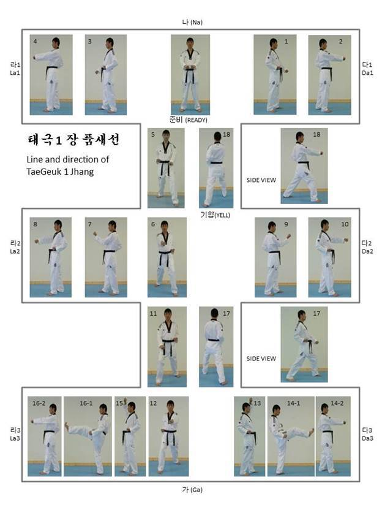
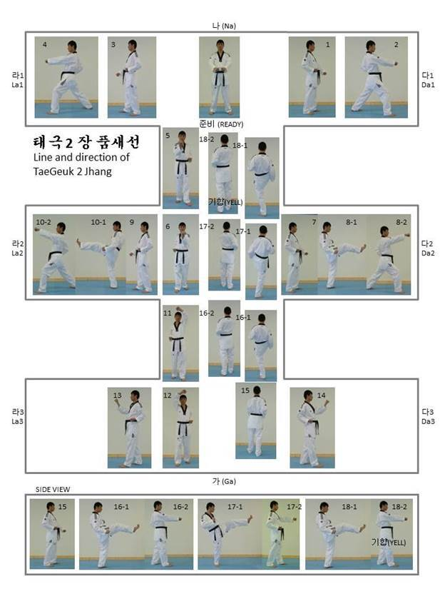
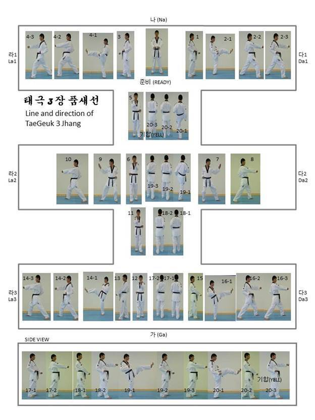
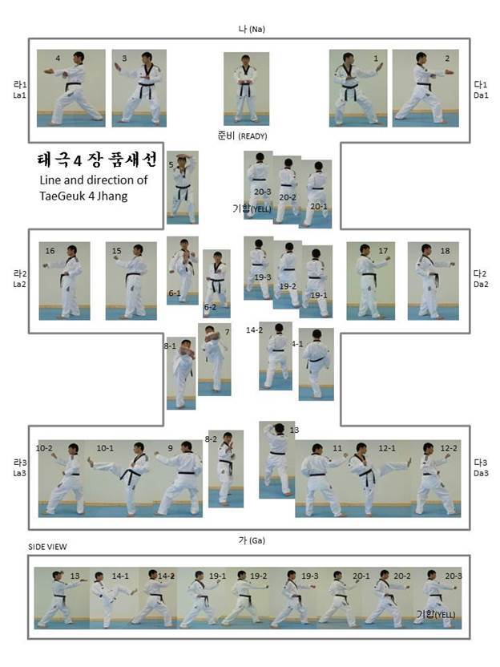
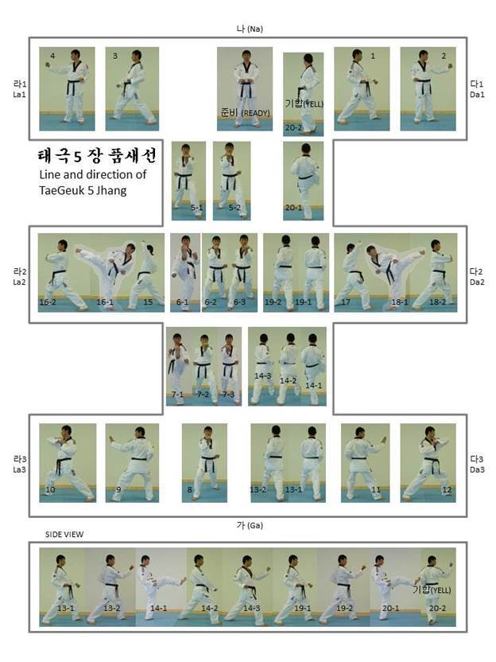
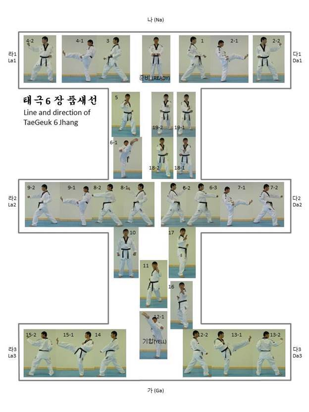
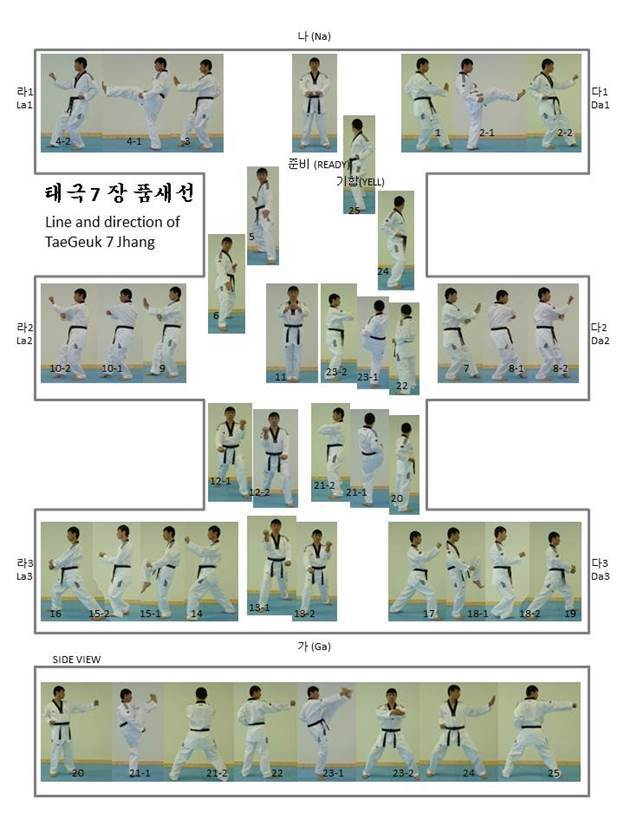
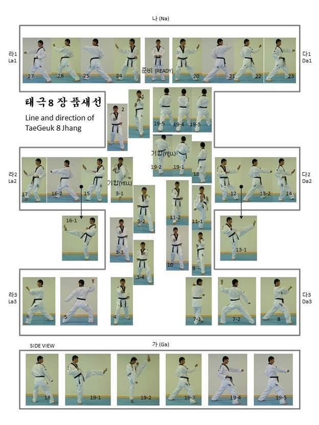

# Taekwondo: understand, practise and reflect

Standalone thematic reference for the enriched course. Read a concept, choose a familiar movement and take one question back to class. This is original didactic synthesis, not a translation of the supplied books, a complete higher-grade syllabus or a certificate of examination readiness.

Languages: **English** · [Español](course-reference.es.md) · [Deutsch](course-reference.de.md).

## Index

- [Scope and safe use](#scope)
- [Movement foundations](#movement)
- [Understanding a technique](#technique-purpose)
- [Blocks: direction, surface and support](#blocks)
- [Principles as practical conduct](#principles)
- [Technique reference: 37 canonical entries](#techniques)
- [Forms and distinct traditions](#patterns)
- [Eight Taegeuk references and authorized plates](#taegeuk)
- [History: tradition and evidence](#history)
- [Optional meditation](#meditation)
- [Warm-up](#warmup)
- [Active mobility](#mobility)
- [Gentle stretching](#stretching)
- [Conditioning and recovery](#conditioning)
- [Practice planning](#practice)
- [Curriculum, examinations and instructor](#curriculum)
- [Sources and limits](#sources)

## Scope and safe use

The manual covers the ten current concept topics, 29 enriched beginner technique records and eight selected higher-level records, forms context, history and the eight supplemental photographic plates. Other higher-level combinations, contact drills, breaking and self-defence applications are not independently validated here. The club programme determines requirements; books supply context, not replacement rules.

Practise only familiar movements in clear, non-slip space. Start slowly, with comfortable range, ordinary continuous breathing and controlled joints. Stop for pain, dizziness, unusual breathlessness, joint discomfort or loss of balance; tingling or numbness also means stop. Rest until comfortable; do not repeat with declining control. Persistent or concerning symptoms need qualified health advice. A text cannot decide whether discomfort is harmless or prescribe rehabilitation.

Seated rehearsal, stable support, smaller turns, lower kicks, reduced range, studying the sequence without moving, or rest are valid alternatives. Ask for individual adaptations when health conditions, injury or uncertainty make an exercise unsuitable. Never force breathing or range. No technique, stretch or meditation guarantees health, injury prevention, weapon protection or success in defence. Partner and pad work require qualified supervision, suitable equipment and agreed intensity; this manual gives no partner-contact recipes or vulnerable-target practice.

## Movement foundations

A stance is a base for moving, not a pose to endure. Balance is the ability to transfer weight, turn and return to readiness while remaining in control. A deeper or wider stance is not automatically better. Keep the knee moving in the same general direction as its foot; release the supporting foot to turn rather than twisting the knee over a planted foot.

Separate the tasks first: rehearse a small step, then add a known arm movement and check whether feet and hands finish together as taught. If the combination becomes unstable, reduce the turn or omit the arm action. Some slow weight shifts with both feet supported reveal more than a fast sequence that conceals wobbling.

Relaxation removes unnecessary tension without collapsing useful support. Notice raised shoulders, a clenched jaw or interrupted breathing. Settle, breathe normally and resume only when comfortable. The club's version takes precedence over fixed book measurements; individual proportions and mobility differ.

## Understanding a technique

Use six questions: **purpose → preparation → movement → common mistake → controlled finish → recovery**. A chamber gives a repeatable starting point for learning a path. The final shape helps an instructor check alignment, but the transition and recovery are equally part of the technique.

Accuracy, timing, speed and force are different qualities. More speed can hide an unstable base; more force can reinforce a poor pathway. In solo air practice, observe one feature, such as wrist alignment or a balanced set-down, instead of trying to fix everything at once. Stop before locking elbows or knees.

Formal basics, forms and sport sparring use different constraints. A hip-start punch is a basic-drill model, not a rule that every live punch must begin at the hip. Likewise, finish a form movement under control before preparing the next; recovery does not mean snapping every block away before the stance settles. Solo repetition cannot teach all judgments about another person's distance or timing.

## Blocks: direction, surface and support

A block manages an incoming line, often through redirection rather than a head-on collision. Position, distance, timing and moving away matter alongside arm shape. A remembered block name does not make its execution reliable in an unpredictable encounter.

| Independent feature | How to read it |
| --- | --- |
| Level | Arae, momtong and olgul distinguish low, middle and high regions. |
| Direction | An and packat describe inward/outward paths in club vocabulary, not additional heights. Ask which reference point is used. |
| Surface | Palmok and sonnal identify forearm or knife-hand tools; inner/outer forearm is not automatically inward/outward travel. |
| Other hand | A single block, a two-hand guarding shape and a reinforced block have different second-hand roles. |

In `sonnal-momtong-kotoro-macki`, the rear hand covers in front of the trunk; it does not push the leading wrist. In `goduro-packat-palmok-packat-macki`, the second fist takes the prescribed supporting position; do not jam it against the wrist. Reinforcement does not make an impact safe. A crossed block and a scissor block are also different: one crosses the wrists at a low line, the other separates the arms into two levels.

Trace a previously taught block slowly in the air, noticing both arms, stance and recovery. Reduce the range if a shoulder rises or balance is lost. Do not collide forearms or invite someone to strike you to test a block. Similar source labels are not proof of identical mechanics across organizations.

## Principles as practical conduct

- **Courtesy:** leave room, listen and respect another person's decision not to participate.
- **Integrity:** admit uncertainty and describe what you actually practised, not what you wish you had mastered.
- **Perseverance:** return to a difficult transition after rest and feedback, not through injury.
- **Self-control:** reduce intensity and honor a stop signal immediately.
- **Indomitable spirit:** speak up, decline unsafe demands and ask for an adaptation when needed.

Choose one observable behavior for the next class and reflect afterward. These five tenets are a useful ethical framework, not proof of moral superiority through rank or an unchanged ancient code. Nervousness and needing rest are not character failures.

## Technique reference: 37 canonical entries

IDs preserve the app's club terminology, including spellings such as macki, chirugi and düt. Match unfamiliar names by trajectory, surface, stance and tradition, not sound alone. A syllabus name may identify a height associated with vulnerable anatomy; it never authorizes contact there. All descriptions below inherit the safe-use boundary above. Pad references mean instructor-supervised work, not a home drill with a partner.

### Stances and readiness

#### `moa-sogi` — club attention stance
For greeting and the beginning or end of practice, bring the heels together, toes slightly apart and arms beside the body. Stand upright without rigid knees or raised shoulders. Breathe normally, settle your balance and step smoothly into the next stance. This is the club convention, not a universal definition of closed stance.

#### `pyonhi-sogi` — comfortable parallel stance
Use this as a mobile readiness base between techniques. Place feet about shoulder-width apart, weight shared evenly and trunk upright. Avoid stiff knees and balancing only on the toes. Relax the shoulders and move into the next action without a preparatory rocking motion.

#### `chuchum-sogi` — horse stance
The broad base supports basic punching and leg control. Step into a comfortable wide parallel stance, bend knees in the direction of the feet and distribute weight evenly. Do not force width or depth or let knees collapse inward. Finish upright with supported feet, then rise or step out smoothly.

#### `ap-sogi` — short walking stance
For mobile transitions, take a natural short step with a small lateral gap between the feet. Keep the front knee soft and trunk upright. Avoid a tightrope line or turning it into an exaggerated long stance. Settle without bouncing, then transfer weight smoothly into the next movement.

#### `ap-gubi` — long forward stance
Build a stable base for blocks and punches on two separate foot tracks. Bend the front knee with the foot direction, extend the rear leg without locking it and keep the rear heel grounded. Do not force depth or lean over the knee. Finish stance and hands together, then shift weight smoothly.

#### `düt-gubi` — back or L-stance
Keep the front foot light for a step or kick. Arrange the feet in an L, bend both knees and settle most weight over the rear leg. Keep the trunk upright and both feet supported. Avoid leaning back or forcing the knees away from foot direction; move out without a preliminary sway.

#### `gibon-junbi-sogi` — basic ready stance
To begin many forms, place the feet parallel and bring both fists into the prescribed rounded position at belt-knot height. Keep weight balanced, elbows relaxed and shoulders down. Avoid clenched shoulders and held breath. Settle before beginning and initiate the first movement without an extra sway.

#### `narani-sogi` — club parallel-outer-edge stance
In club usage, toes point slightly inward so the outer foot edges are parallel. Kukkiwon narani seogi instead uses forward toes: do not silently swap conventions. Place the feet without forcing knees inward, balance weight and relax the shoulders. Finish upright, breathing normally and ready to step; ask about an uncomfortable position.

#### `bom-sogi` — tiger stance; selected higher-level entry
A light front foot supports transition to a step or kick. Bend both knees, settle most weight on the rear leg and touch the front ball down with only a slight heel lift. Keep trunk upright and knees aligned with feet. Do not force heel height or lean back; regain balance and move without rocking first.

### Punches and hand strikes

#### `momtong-chirugi` — basic middle straight punch
From a stable stance, prepare the fist at the hip and send it straight forward, coordinating hip turn and returning hand. Align the first two knuckles with a straight wrist. Avoid raised shoulders and a locked elbow. Finish under control, release unnecessary tension and recover guard; the hip preparation belongs to this basic drill.

#### `hansonnal-mok-chicki` — inward knife-hand strike
The syllabus names neck height, not a safe partner target. Prepare the open hand outside, fingers together and thumb tucked; guide the hand edge inward with the hip turn. Avoid a bent wrist or uncontrolled swing. Rehearse in air or toward a supervised pad, never a partner's neck; brake and recover guard.

#### `pyonsonkut-sewo-jirugi` — vertical fingertip thrust; selected higher-level entry
This trunk-level formal thrust trains a direct path and hand alignment. Prepare a flat vertical hand, fingers together and wrist straight, then extend with the stance. Avoid splayed fingers or a locked elbow. Practise the shape in air only, not into a person or hard target: fingers are vulnerable. Stop and withdraw to readiness.

#### `dung-jumok-olgul-ape-chicki` — forward/downward back-fist; selected higher-level entry
The club specifies a forward and downward path at face height. Prepare near the body and extend around the elbow pivot with the wrist aligned, not flicking loose. Coordinate the stance and stop short of elbow lock. Air or supervised pad practice only, never a partner's nose; withdraw to guard after the controlled finish.

#### `me-jumok-naeryo-chicki` — descending hammer-fist; selected higher-level entry
Use the fleshy bottom of the closed fist for a downward pad-oriented action. Prepare beside the head, then guide down with a straight wrist while the other hand covers. Avoid an oversized swing, locked elbow or striking your own thigh. Brake and recover guard; a fleshy surface does not remove injury risk.

#### `sonnaldung-an-mok-chicki` — inward ridge-hand; selected higher-level entry
This uses the thumb-side edge, not the little-finger-side knife-hand edge. Prepare outside with the thumb securely tucked, then guide inward with the hip. Keep fingers together and wrist aligned; avoid an exposed thumb or overswing. The named neck height is not permission for contact: use air or a supervised pad, stop and recover guard.

### Blocks

#### `arae-macki` — low forearm block
To rehearse redirecting a low line, prepare the fist near the opposite shoulder and sweep the forearm down and outward as the other hand returns. Keep the elbow slightly bent. Avoid hitting your own leg or dragging the shoulder down. Stop above the knee with the stance, then release tension into readiness.

#### `olgul-macki` — rising block
Prepare across the body and raise the forearm just above the brow, elbow bent, to rehearse an upper-line redirection. Leave space from the head and incline the forearm rather than opposing force head-on. Do not raise the shoulder. Finish balanced and return to readiness; no weapon-protection guarantee follows from this shape.

#### `momtong-an-macki` — inward middle block
Prepare the working arm outside, then sweep inward with hip turn and returning hand to clear the trunk line. Stop at the centre line with a bent elbow. Crossing too far opens the opposite side. Settle the stance, finish under control and release excess tension before the next action.

#### `momtong-packat-macki` — outward middle block
Prepare the forearm across the body and open outward with coordinated hip turn and returning hand. Keep the elbow bent and shoulder low. Avoid sweeping behind the body: finish in front of the side being covered. Recover readiness without stiffening the whole body.

#### `hansonnal-arae-macki` — low knife-hand block
Prepare near the opposite shoulder and guide the hand edge down across the body. Fingers stay together, thumb tucked and wrist aligned. Avoid elbow lock and striking your own knee. Coordinate the returning hand with the stance, stop above the knee and relax into readiness.

#### `momtong-hansonnal-packat-macki` — single outward knife-hand middle block
Prepare across the body and open the hand edge outward with hip and stance coordination. Keep fingers together, thumb tucked and elbow bent. Do not reach behind the shoulder. Keep the other hand in its prescribed covering position; finish balanced and ready to move again, not frozen at maximum range.

#### `sonnal-momtong-kotoro-macki` — two-hand knife-hand guarding block
Prepare both arms; send the leading hand outward while the rear hand covers before the trunk. Maintain aligned wrists and softly bent elbows. Do not press the rear hand into the leading wrist or confuse this with mechanical reinforcement. Finish both hands with the stance, leaving room for controlled recovery.

#### `goduro-packat-palmok-packat-macki` — reinforced outward forearm block
Prepare both arms, guide the blocking forearm outward and place the second fist in its supporting position. Keep shoulder down and elbow bent. Do not jam the support into the wrist or assume two arms make any collision safe. Finish balanced, release excess tension and recover readiness.

#### `otgoro-arae-macki` — low cross block; selected higher-level entry
Prepare both arms and guide the crossed wrists downward before the body to rehearse a low interception line. Keep elbows slightly bent and trunk upright. Avoid reaching down or assuming the shape safely stops any kick. Finish with the stance, then uncross into readiness; do not test it by receiving impacts.

#### `an-palmok-gawi-macki` — scissor block; selected higher-level entry
Prepare crossed arms, then separate into a low block and an outward inner-forearm middle block with the stance. Keep elbows softly bent and shoulders low. Avoid colliding wrists or finishing one arm late. Complete both actions together and prepare the next movement; the two levels do not promise to stop simultaneous attacks.

### Kicks and knee action

#### `ap-chagi` — front kick
For a direct pad-oriented line, raise the knee first, then extend with the ball of the foot and toes drawn back. Keep the supporting knee soft and hands guarding. Avoid leaning backward or locking the kicking knee. Re-bend the knee before placing the foot down under control; lower the height when needed.

#### `dollyo-chagi` — roundhouse kick
Raise the knee and pivot the supporting foot as the hip turns; extend along a curved line toward a supervised pad. Use instep or ball as instructed, with its matching toe position. Do not twist a planted knee or drop guard. Re-bend the kicking knee and set down with balance.

#### `yop-chagi` — side kick
Chamber the knee, turn sideways and pivot the supporting foot to align the hip for a straight thrust. Guide heel or outer foot edge toward the supervised pad. Avoid supporting-knee twist or kicking-knee lock. Keep guard, retract along the same line and set down balanced rather than falling onto the next step.

#### `naeryo-chagi` — descending axe kick
Raise the leg only within a comfortable range, keep the trunk controlled and guide the heel down toward a supervised pad. Do not chase height, lock the knee or use a person's head or collarbone as a target. Brake the descent and settle in balance; controlled lowering is more important than amplitude.

#### `düt-chagi` — back kick
Turn to identify the supervised pad over the shoulder, chamber and send the heel straight backward. The body turns into position; the kick is not a circular sweep. Let the supporting foot turn, avoiding knee twist and excessive forward lean. Retract, regain sight of the training space and set down controlled. Never kick blindly.

#### `an-naeryo-chagi` — inward axe kick
Raise the leg outside the intended line and guide the heel down toward the centre. Keep the rise comfortable and torso steady; do not force a straight knee or confuse the descending heel with a sideways crescent sweep. Use air or a supervised pad, never a person's head. Brake and set down balanced.

#### `packat-naeryo-chagi` — outward axe kick
Raise toward the centre and guide the heel down slightly outward, allowing the supporting foot to turn freely. Do not force height or change the descending action into a sideways crescent sweep. With air or supervised pad rehearsal, control the descent and regain a stable stance; never drop onto a partner's head.

#### `twio-chagi` — jump-kick family
This family trains airborne timing and balance, not a mandatory run-up or maximum height. First learn the corresponding grounded kick and a small jump with a quiet landing under supervision. Chamber, kick and retract before landing with soft knees. Avoid chasing distance; use clear space and recover guard and balance before continuing. Grounded rehearsal is a valid alternative.

#### `twio-ap-chagi` — jumping front kick
First control ap-chagi on the ground. Under supervision, combine a small jump with knee lift, front extension with toes back and retraction while airborne. Keep guard; do not throw the body backward for height. Land with soft knees in clear space and regain balance before repeating. Return to grounded practice if landing control is absent.

#### `murup-chicki` — knee action; selected higher-level entry
For this close-range, instructor-held body-pad context, establish supporting-leg balance and lift the bent knee forward with toes pointing down. Keep hands guarding and trunk controlled. Do not pull a partner's head or lean back to gain height. Lower the leg under control and recover the stance before repeating; solo rehearsal omits contact.

### Four-direction preparatory drills

#### `saju-macki` — four-direction blocking drill
This is a club preparatory drill, not a form: low knife-hand block, then middle forearm block with quarter turns. Prepare each arm and look into the new direction before turning. Coordinate feet and hands; do not twist over a fixed foot or rush corners. Finish each block balanced and ready before continuing.

#### `saju-chirugi` — four-direction punching drill
This club drill, not a form, links low block and middle punch in a long forward stance with quarter turns. Look first, prepare the next technique and coordinate stance and hands. Avoid rushing, crossing feet or locking the punching elbow. Finish each action balanced and recover readiness before changing direction.

## Forms and distinct traditions

A form connects remembered order with transitions, direction, rhythm, breathing and purpose. Knowing the sequence is only the beginning. Rehearse a short known section slowly, check one transition and ask for one correction. Returning near the start can expose inconsistent steps but does not prove every technique correct. With limited space, mark directions or recall the order seated.

**Keep three contexts separate:** ITF Chang-Hon patterns (tul/teul; club Hyong spelling), classic Hyung from traditional schools, and Kukkiwon Taegeuk poomsae. Sharp's 24-pattern chapter is ITF context. Hillson's Kuk Mu 1 is not Taegeuk Il Jang. A shared rank or the word Hyung does not imply identical choreography. Club Chang-Hon records include Chong-Ji, Tang-Gun, To-San and later forms; Yudanja records cover black-belt poomsae from Koryo onward. This manual does not rewrite their complete sequences or validate every inherited historical meaning.

Use the app's floor diagram for route orientation and Woo's photographic plate as a supplemental movement reference. Viewpoint, subframes and timing differ; ask the instructor about transitions. A still image cannot establish correct execution, distance or rhythm. Keep earlier forms in practice instead of abandoning them when a new sequence arrives.

## Eight Taegeuk references and authorized plates

Names, symbols and counts below follow current app data, not an asserted universal counting standard. Club **exam Kup** and another school's **video-course Keup** are separate fields: 0 in the club field means 1st Dan, not a zero-rank belt. Colours and book gradings must not replace the club mapping.

| App ID / Kukkiwon name | App movements | Club exam Kup | Video Keup | Symbol and reflection cue |
| --- | ---: | ---: | ---: | --- |
| `taeguk-1` / Taegeuk Il Jang | 18 | 7 | 8 | Heaven and light: build clear direction and a dependable beginning. |
| `taeguk-2` / Taegeuk I Jang | 18 | 6 | 7 | Still water/lake: seek calm control, not limp movement. |
| `taeguk-3` / Taegeuk Sam Jang | 20 | 5 | 6 | Fire: distinguish purposeful energy from rushing. |
| `taeguk-4` / Taegeuk Sa Jang | 20 | 4 | 5 | Thunder/lightning: pause to regain calm rather than force confidence. |
| `taeguk-5` / Taegeuk O Jang | 20 | 3 | 4 | Wind: study changes between transitions and stable finishes. |
| `taeguk-6` / Taegeuk Yuk Jang | 19 | 2 | 3 | Flowing water: coordinate turns without twisting planted knees. |
| `taeguk-7` / Taegeuk Chil Jang | 25 | 1 | 2 | Mountain: distinguish a controlled stop from whole-body rigidity. |
| `taeguk-8` / Taegeuk Pal Jang | 27 | 0 (1st Dan) | 1 | Earth: revisit basics while linking more complex transitions. |

Reflection cues are editorial learning prompts, not official technique lists. The app's club spelling for number 7 is “Sil-Chang”; Kukkiwon uses Chil Jang. Woo's eighth plate numbers positions through 27 and the current app also stores 27; the commonly encountered 24-movement count is a different counting convention. This manual changes neither. Do not equate each photograph/subframe with one formally counted movement.

All eight captions below preserve the source's localized caption and permission context. Embedded labels remain **English/Korean**, not translated lessons. Images are 624×832; open the image for enlargement. A textual overview cannot replace accessible instruction of every photographed step.

### Taegeuk 1 plate — `taeguk-1`

Taegeuk 1: supplemental full-form photographic reference. Embedded text: English and Korean. Follow the numbered movements with your instructor; this is not a translated lesson. **Sung Woo, _Taekwondo Poomsae (Taegeuk 1-8 Jang)_, © 2015 Sung Woo. All rights reserved. Used with owner-confirmed permission.** Chapter `OEBPS/cSD.xhtml`; plate `OEBPS/image_rsrc223.jpg`.

### Taegeuk 2 plate — `taeguk-2`

Taegeuk 2: supplemental full-form photographic reference. Embedded text: English and Korean. Follow the numbered movements with your instructor; this is not a translated lesson. **Sung Woo, _Taekwondo Poomsae (Taegeuk 1-8 Jang)_, © 2015 Sung Woo. All rights reserved. Used with owner-confirmed permission.** Chapter `OEBPS/cTZ.xhtml`; plate `OEBPS/image_rsrc224.jpg`.

### Taegeuk 3 plate — `taeguk-3`

Taegeuk 3: supplemental full-form photographic reference. Embedded text: English and Korean. Follow the numbered movements with your instructor; this is not a translated lesson. **Sung Woo, _Taekwondo Poomsae (Taegeuk 1-8 Jang)_, © 2015 Sung Woo. All rights reserved. Used with owner-confirmed permission.** Chapter `OEBPS/cVS.xhtml`; plate `OEBPS/image_rsrc225.jpg`.

### Taegeuk 4 plate — `taeguk-4`

Taegeuk 4: supplemental full-form photographic reference. Embedded text: English and Korean. Follow the numbered movements with your instructor; this is not a translated lesson. **Sung Woo, _Taekwondo Poomsae (Taegeuk 1-8 Jang)_, © 2015 Sung Woo. All rights reserved. Used with owner-confirmed permission.** Chapter `OEBPS/cYJ.xhtml`; plate `OEBPS/image_rsrc226.jpg`.

### Taegeuk 5 plate — `taeguk-5`

Taegeuk 5: supplemental full-form photographic reference. Embedded text: English and Korean. Follow the numbered movements with your instructor; this is not a translated lesson. **Sung Woo, _Taekwondo Poomsae (Taegeuk 1-8 Jang)_, © 2015 Sung Woo. All rights reserved. Used with owner-confirmed permission.** Chapter `OEBPS/c10V.xhtml`; plate `OEBPS/image_rsrc227.jpg`.

### Taegeuk 6 plate — `taeguk-6`

Taegeuk 6: supplemental full-form photographic reference. Embedded text: English and Korean. Follow the numbered movements with your instructor; this is not a translated lesson. **Sung Woo, _Taekwondo Poomsae (Taegeuk 1-8 Jang)_, © 2015 Sung Woo. All rights reserved. Used with owner-confirmed permission.** Chapter `OEBPS/c13M.xhtml`; plate `OEBPS/image_rsrc228.jpg`.

### Taegeuk 7 plate — `taeguk-7`

Taegeuk 7: supplemental full-form photographic reference. Embedded text: English and Korean. Follow the numbered movements with your instructor; this is not a translated lesson. **Sung Woo, _Taekwondo Poomsae (Taegeuk 1-8 Jang)_, © 2015 Sung Woo. All rights reserved. Used with owner-confirmed permission.** Chapter `OEBPS/c165.xhtml`; plate `OEBPS/image_rsrc229.jpg`.

### Taegeuk 8 plate — `taeguk-8`

Taegeuk 8: supplemental full-form photographic reference. Embedded text: English and Korean. Follow the numbered movements with your instructor; this is not a translated lesson. **Sung Woo, _Taekwondo Poomsae (Taegeuk 1-8 Jang)_, © 2015 Sung Woo. All rights reserved. Used with owner-confirmed permission.** Chapter `OEBPS/c18P.xhtml`; plate `OEBPS/image_rsrc22A.jpg`.

Permission is the owner's recorded assertion (“Tengo permiso para reutilizarlas”), not independent rights clearance or a downstream blanket licence. The book title's “Official” claim does not establish WT/Kukkiwon endorsement. These plates are not CC-licensed; existing Wikimedia floor diagrams retain their separate actual attribution/licences. No whole book is reproduced or authorized for upload here.

## History: tradition and evidence

Taekwondo is Korean, but cultural memory and documented modern development answer different questions. Tangun/Dangun's foundation of Gojoseon in **2333 BC** is a foundation myth, not a verified Taekwondo date. The Hwarang inspire modern form symbolism; that does not prove uninterrupted technical transmission from ancient Silla.

The course's broad historical frame includes the Three Kingdoms (57 BC–668), Unified Silla (668–935), Goryeo/Koryo (918–1392) and Joseon dynastic rule (1392–1910; Korean Empire from 1897). Goryeo's rise overlaps Silla's end. Japanese colonial rule is **1910–1945**, not Sharp's 1909 annexation claim. Modern kwans develop from the 1940s through several instructors, many influenced by karate. Korea is divided into occupation zones in 1945; the Korean War runs 1950–1953, with the armistice on 27 July 1953.

| Milestone | Meaning and limit |
| --- | --- |
| 1955 naming proposal | Choi Hong Hi promotes “Taekwondo”; school acceptance is gradual, not unanimous. |
| 1959 demonstration tour | The club timeline records Choi's 19-person Far East team; this is inherited club context. |
| 22 March 1966, Seoul | ITF founded; Choi is its first president, not the undisputed sole founder of all Taekwondo. |
| 1960s–1970s | Committees develop Palgwae, Taegeuk and black-belt poomsae; exact development dates vary. |
| 1972 Toronto | ITF headquarters moves; this is not its founding date. |
| 30 November 1972, Seoul | Kukkiwon founded: education and Dan/Poom certification, distinct from the sport federation. |
| 28 May 1973, Seoul | WTF founded as international sport federation; renamed World Taekwondo (WT) in 2017. |
| 1988 Seoul | Olympic Games in the existing course timeline; do not confuse this date with institutional foundations. |

Choi (9 November 1918–15 June 2002) studied karate in Japan and became an influential modern organizer, international promoter and Chang-Hon contributor. His central ITF role need not erase other kwans. The short quiz therefore asks about **first ITF president**, **1955 naming proposal** and **Hyong/Tul association**, rather than claiming a sole-founder consensus. The club's 1994 foundation and belt-symbol questions concern local records or tradition, not universal institutional history.

Evidence strength is unequal: the parent research directly fetched [Kukkiwon's official introduction](https://www.kukkiwon.or.kr/eng/contents/view?contentsNo=78&menuLevel=2&menuNo=80) supporting 30 November 1972. [ITF history](https://itftkd.sport/history/our-history/?noredirect=en-GB) was corroborated by search result only; direct fetch returned 403. WT day-level corroboration came from an official PDF search result whose full text was not successfully extracted; no exact PDF URL was supplied. These manuals did not independently refetch them. Pottle's history supports the broad dates but its Associations section contradicts them; that section is not adopted as authority.

## Optional meditation

Meditation here is optional attention practice, not treatment or a requirement for Taekwondo. Sit comfortably on a stable chair or stand with support. Notice a few ordinary breaths without making them deeper, slower or longer. Breathe continuously: no holding or forced exhalation. When distracted, acknowledge it and return gently to the natural breath or the room. A few moments suffice; there is no target duration.

Eyes-open observation or calmly naming the next movement is an equally valid alternative. Skip it if uncomfortable. Stop for dizziness, breathlessness or distress, look around and return to ordinary activity; tell the instructor if help is needed. Attention must never be used to ignore pain or pressure someone into contact. Sharp's maximal breath-retention instructions and broad health claims are deliberately excluded.

## Warm-up

Warm-up gradually prepares the movements ahead; it is not an endurance or flexibility test. In clear, non-slip space, choose easy walking or seated marching, then some short slow steps into a familiar stance and small-range rehearsals. Start with little and pause to check comfort. You should still be able to speak comfortably.

No compulsory circuit, timer or repetition quota is added: the current concept module leaves this adaptable. Rest whenever needed and settle before continuing. Stop for pain, dizziness, unusual breathlessness or lost balance. High kicks are not proof that you are warm; ask for another preparation when a movement is unsuitable.

## Active mobility

Mobility is active movement through a controlled range, unlike holding a stretch. Small shoulder circles, gentle ankle movements and supported slow weight shifts can explore available movement before technique work. Keep turns small and use a chair or stable support as needed; omit any movement you cannot control.

Do not pull the neck, force joint circles, bounce into end range or treat a book's measurements as a target. Seated versions are valid. These options complement warm-up but neither warm-up nor mobility is interchangeable with static stretching. Pause if shoulders rise, joints hurt or balance deteriorates; reduce or stop rather than forcing a larger arc.

## Gentle stretching

Warm up first. Optional gentle static stretching after easy practice explores comfortable range, not splits or maximum height. With hands on a stable wall, take a short staggered stance and move gently forward until there is a light calf stretch in the rear leg, keeping that heel supported. Shorten the stance to reduce it.

If comfortable, hold **about 10 seconds per side**, release slowly and rest between sides. This is the current concept module's optional example, not a required dose; omit it when unsuitable. Breathe normally. Stop for pain, tingling, numbness or joint discomfort; you need not call discomfort “good” and push through it.

No bouncing, neck pulling, forcing knees down or partner pushing/lifting. Maximal holds, partner-assisted stretches and contraction-against-resistance methods are not taught. Stretching is neither an injury-prevention guarantee nor rehabilitation. Persistent symptoms require qualified advice, not a deeper stretch.

## Conditioning and recovery

Conditioning supports repeated controlled movement; exhaustion is not the goal. Strength and easy endurance serve different tasks, and neither replaces technique. With instructor guidance, choose a familiar comfortable option. This is general education, not an individualized programme or a copied heavy-lifting routine.

The optional strength example is **3 slow rises from a stable chair**, using hands for support if needed. Sit back down under control, without dropping. A higher stable seat or merely a small supported weight shift makes the task easier. Comfortable walking or seated marching is an easy-endurance alternative, not another mandatory station.

Breathe throughout. Rest after the small effort until breathing and balance are comfortable. End rather than repeat with deteriorating control. Pain, dizziness, unusual breathlessness or joint discomfort means stop, not “one more”. Allow recovery between demanding sessions; reduce or skip activity when unusually tired or sore. Seek qualified help for persistent or concerning symptoms or uncertainty about suitability.

## Practice planning

1. **Check readiness:** clear space and notice fatigue or symptoms; choose physical practice, seated recall or rest.
2. **Prepare gently:** choose suitable warm-up/mobility, not all examples as a circuit.
3. **Choose one known task:** a stance transition, one block pathway or a short form section.
4. **Observe one cue:** for example, “my supporting foot could turn” or “both arms finished together”. Pause as attention or quality drops.
5. **Record feedback:** what changed, what remained unclear and one question for class. Leave recovery afterward.

There is no imposed daily total or target duration. Progress may mean fewer reminders, comfort on both sides or understanding a transition, not a higher kick or earlier test. Change one demand at a time with guidance. Revisit earlier basics. A plateau is not evidence of laziness; do not use a streak to override pain, illness or fatigue.

## Curriculum, examinations and instructor

The app combines beginner records with curriculum slices for Kup 7–5, Kup 4–3 and Kup 2–1st Dan. This reference explains the integrated enrichment, not every record in those slices or all higher-level form-specific combinations. Its 37 entries are a content boundary, not the complete examination checklist. The club programme, current instructor guidance and required form version determine assessment.

Club Taegeuk exam assignments differ from video-course grades as shown above. Chang-Hon Hyong and Yudanja are separate tracks, not replacements chosen by matching belt colours. Memorizing a manual, completing app quizzes or reproducing a plate does not certify readiness. Ask the instructor which form system, technique variant, theoretical material and supervised assessment apply to you.

Use the manual before or after class: explain a purpose in your own words, show only a familiar low-risk action and request one correction. Courtesy and integrity include acknowledging the limits of solo learning. Neither this text nor its source books authorize unsupervised contact, weapon practice or vulnerable-target applications.

## Sources and limits

### Evidence trail

The [seven-book source ledger](epub-sources.md) records supplied filenames, metadata, copyright evidence, internal locators, image identity and hashes. The [technique note](curriculum/epub-techniques.md), [concept note](curriculum/epub-concepts.md) and [history note](curriculum/epub-history.md) explain source conflicts and excluded prescriptions. [Existing club attribution](sources.md) and [background research](background-research.md) remain part of the chain, including `HoSinSul-TKD-PO-Korea_2025-01.pdf` and `HoSinSul-TKD-PO-Formen.pdf`; those PDFs were not newly re-extracted for this manual.

Current app counterparts: [concepts](../src/data/concepts.ts), [beginner descriptions](../src/data/techniqueInfo.ts), [higher curriculum](../src/data/curriculum/index.ts), [forms](../src/data/forms.ts), [form grades](../src/data/curriculum/forms-extra.json), [timeline](../src/features/history/timeline.ts), [theory](../src/data/theory.ts) and [image attribution data](../src/data/bookFormImages.json). Source members below are archive locators, not public download links or print page numbers. The synthesis uses the critically read integration evidence; it does not claim exhaustive independent verification of every book.

### Seven books and how to use their evidence

| Book | Internal members / headings used in the evidence chain | Contribution and limitation |
| --- | --- | --- |
| Clint Sharp, _Taekwondo: A Comprehensive Guide to Tae Kwon Do Techniques, Basics, and Tenets for Beginners Wanting to Master This Martial Art_ (2022) | `OEBPS/c2A.xhtml` History; `c84.xhtml` Fundamental Movements; `cMP.xhtml` Hands; `cS9.xhtml` Feet; `cYG.xhtml` Blocks; `cFT.xhtml` 24 Patterns; `cJC.xhtml` Tenets; `cDF.xhtml` Meditation; `c11H.xhtml` Stretches and Drills; `c148.xhtml` Habit | Broad topic framework, compared against clearer technical evidence. Mixed organizational vocabulary, historical conflations, forced ranges, toe-balance defaults and breath retention are not adopted. |
| Adam Gold, _CODE Taekwon-Do Theory book (ITF)_ (2016) | `OEBPS/c9.xhtml`: Tenets, Oath and Dojang Rules, Kup grading headings, Hand Techniques / Common Principles | ITF ethical/terminological comparison, not club or WT grading authority. Much technical material is in image tables; searchable text is incomplete. No located copyright notice does not mean free reuse. |
| Ted Hillson, _Tae Kwon Do Classic Forms: 21 Hyung_ (2013 electronic edition) | `OEBPS/9WW6B7coRdqC8rCI3f6o7g141.xhtml`: How to use this book / Brief Modern History; `...g437.xhtml`: Kuk Mu 1; `...g10.xhtml`: contents | Intention, stylistic variation and modern forms context. Classic Hyung are not Taegeuk. No Hillson images are used; historical claims remain secondary. |
| Scott McMillan, _TaeKwon-Do and Martial Arts Sparring — OUR WAY_ (2024) | `OEBPS/cBW.xhtml` Development Process; `cJW.xhtml` Movement/Timing/Distance; `cACU.xhtml` Four Phases; `cC7U.xhtml` Set-reset; `cCR6.xhtml` Competition | Progression, distance, timing and reset as coaching context. TAGB/light-continuous/point-stop contexts are not WT rules. No head-target drills or photo fragments imported; photography credits remain in ledger (`cJ.xhtml`). |
| Sung Woo, _Taekwondo Poomsae (Taegeuk 1-8 Jang)_ (2015) | `OEBPS/c66.xhtml` What is Poomsae; `c6D.xhtml` Trigrams; `c6U.xhtml` Overview; `cMS.xhtml` Stances; `cNH.xhtml` Blocks; chapters/plate members in captions | Direct Taegeuk photographic reference. Self-published metadata and “Official” title do not verify endorsement; romanization, school grading and numbering vary. Eight identified plates only. |
| Bill & Katie Pottle, _Taekwondo: A Practical Guide to the World's Most Popular Martial Art: 2025 Update_ | `OEBPS/c4Z.xhtml` History/Philosophy; `cFM.xhtml` Stances; `cJG.xhtml` Kicks; `cNE_split_000.xhtml` Blocks; `cNE_split_001.xhtml` Forms/Levels of Knowing; `c19A.xhtml` Sport Poomsae; `c2D4.xhtml` Training; `c2GV.xhtml` Stretching | Practical comparison, form-learning and process goals. History adapts federation narratives, with internal contradictions. OPF date is 2013 despite update title. Pain-normalizing, forced stretching, nutrition/weight-cutting and grappling prescriptions are excluded. |
| Bryan McWhorter, _Ultimate Tae Kwon Do: A Training Guide for Martial Arts_ (2016) | `OEBPS/c6Z.xhtml` Goals; `c9Y.xhtml` Training; `cD5.xhtml` Speed; `cFM.xhtml` Accuracy; `cHC.xhtml` Power; `cJ8.xhtml` Form; `cM1.xhtml` Hyungs; `cPB.xhtml` Sparring; `cYR.xhtml` Fear | Goals, feedback and mechanics in practitioner context, not normative standards. Guard-start versus chambered punches shows why context matters. No large strike quotas, force guarantees or harmful applications adopted. |

### What remains uncertain

Exact club variants remain club data when books only match a family. Narani conventions, jump-kick prerequisites and four-direction drill sequences are not claimed as exact Sharp recipes. Gold's image tables limit text-only comparison; most non-Woo imagery is not individually verified. Historical symbols and inherited form meanings are not primary historical proof. Current sport rules require separate current verification.

The exercises here are conservative editorial options matching the current concepts: approximately 10 seconds per side and 3 chair rises, never compulsory doses. They do not endorse every prescription in the books. No full EPUB extraction, whole-book translation or source-book modification is part of this manual. Independent technical, language, safety and source review (parent risk item 6) remains necessary; structural checks cannot certify those judgments.
