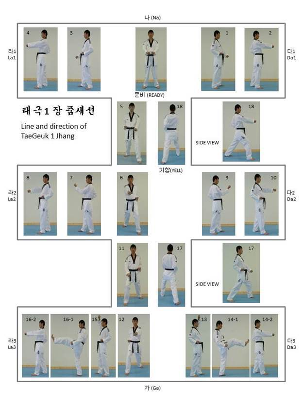
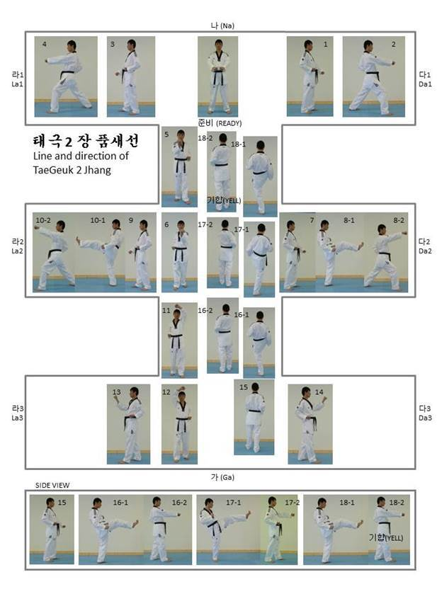
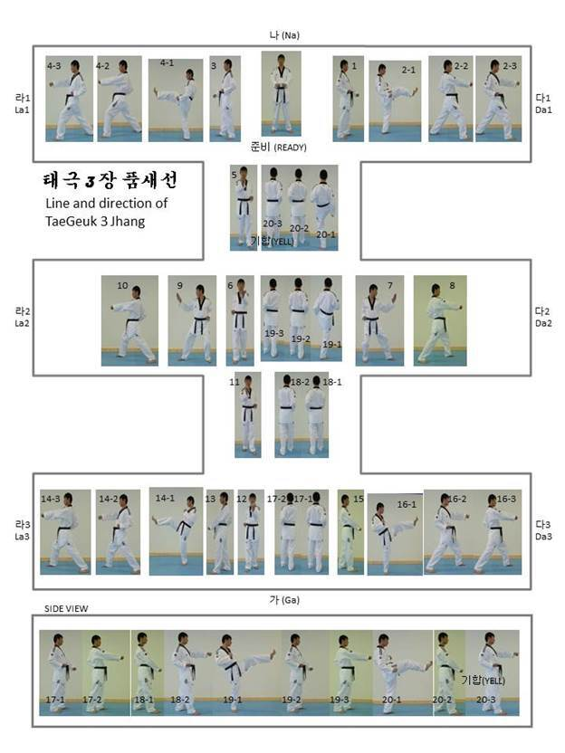
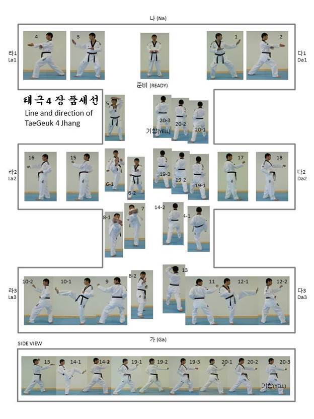
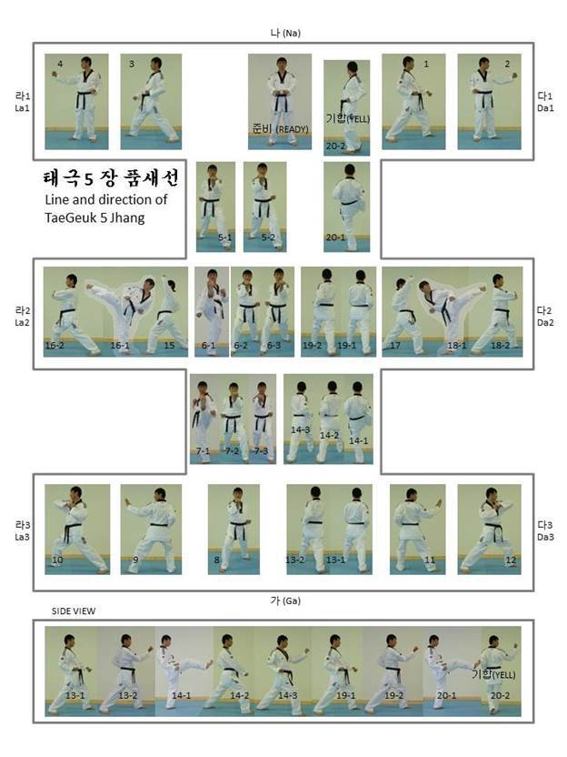
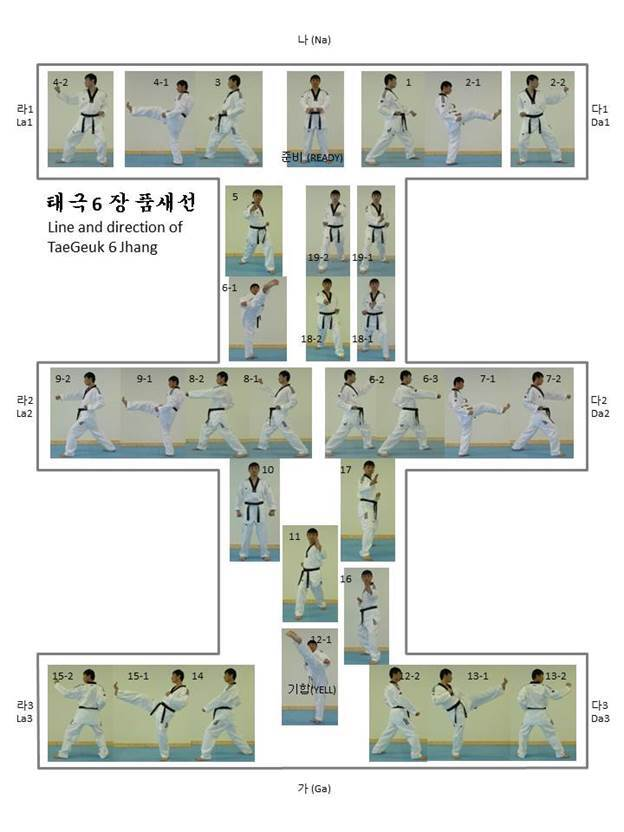
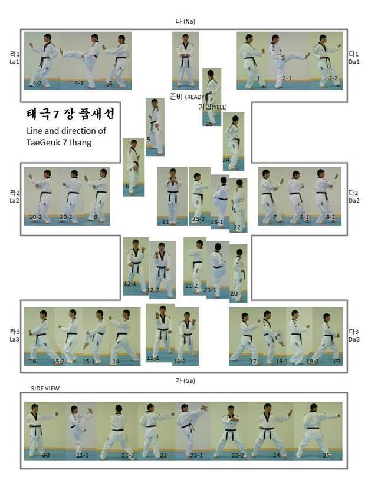
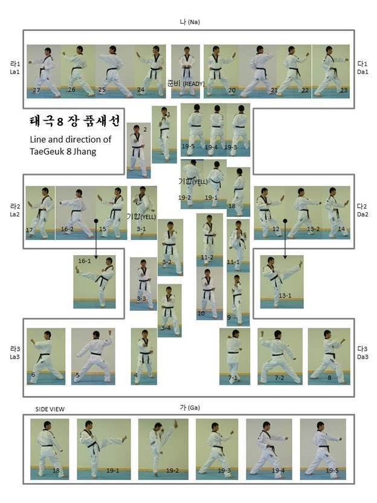

# Taekwondo: comprender, practicar y reflexionar

Referencia temática autónoma del curso enriquecido. Lee un concepto, elige un movimiento conocido y lleva una pregunta a clase. Es una síntesis didáctica original, no una traducción de los libros suministrados, un programa completo de grados superiores ni un certificado de preparación para examen.

Idiomas: [English](course-reference.en.md) · **Español** · [Deutsch](course-reference.de.md).

## Índice

- [Alcance y uso seguro](#scope)
- [Fundamentos del movimiento](#movement)
- [Comprender una técnica](#technique-purpose)
- [Bloqueos: dirección, superficie y apoyo](#blocks)
- [Principios como conducta práctica](#principles)
- [Referencia técnica: 37 entradas canónicas](#techniques)
- [Formas y tradiciones distintas](#patterns)
- [Ocho Taegeuk y láminas autorizadas](#taegeuk)
- [Historia: tradición y evidencia](#history)
- [Meditación opcional](#meditation)
- [Calentamiento](#warmup)
- [Movilidad activa](#mobility)
- [Estiramientos suaves](#stretching)
- [Preparación física y recuperación](#conditioning)
- [Planificación de la práctica](#practice)
- [Programa, exámenes e instructor](#curriculum)
- [Fuentes y límites](#sources)

## Alcance y uso seguro

El manual cubre los diez temas conceptuales actuales, 29 registros técnicos iniciales enriquecidos y ocho registros superiores seleccionados, contexto de formas, historia y ocho láminas fotográficas complementarias. No valida independientemente otras combinaciones superiores, ejercicios de contacto, rompimientos ni aplicaciones de defensa personal. El programa del club determina los requisitos; los libros aportan contexto, no reglas sustitutas.

Practica solo movimientos conocidos en un espacio despejado y antideslizante. Empieza despacio, con recorrido cómodo, respiración normal continua y articulaciones controladas. Para ante dolor, mareo, falta de aire inusual, molestias articulares o pérdida de equilibrio; también ante hormigueo o entumecimiento. Descansa hasta estar cómodo; no repitas perdiendo control. Los síntomas persistentes o preocupantes necesitan orientación sanitaria cualificada. Un texto no puede decidir si una molestia es inofensiva ni prescribir rehabilitación.

Ensayar sentado, usar apoyo estable, reducir giros, bajar patadas, acortar recorridos, estudiar la secuencia sin moverse o descansar son alternativas válidas. Pide adaptaciones individuales si una enfermedad, lesión o duda hace inadecuado un ejercicio. Nunca fuerces respiración ni amplitud. Ninguna técnica, estiramiento o meditación garantiza salud, prevención de lesiones, protección frente a armas ni éxito defensivo. El trabajo con compañero y paos requiere supervisión cualificada, equipo adecuado e intensidad acordada; aquí no se dan recetas de contacto ni práctica sobre zonas vulnerables.

## Fundamentos del movimiento

Una posición es una base para moverse, no una postura que soportar. Equilibrio significa trasladar el peso, girar y recuperar la preparación manteniendo el control. Más anchura o profundidad no siempre es mejor. La rodilla acompaña la dirección general del pie; deja girar el pie de apoyo en vez de retorcer la rodilla sobre un pie clavado.

Separa primero las tareas: ensaya un paso pequeño, añade un movimiento de brazos conocido y comprueba si pies y manos terminan juntos como se enseña. Si pierdes estabilidad, reduce el giro u omite los brazos. Unos cambios lentos de peso con ambos pies apoyados revelan más que una secuencia rápida que oculta el tambaleo.

Relajarse es eliminar tensión innecesaria sin perder sostén. Observa hombros elevados, mandíbula apretada o respiración interrumpida. Asienta, respira normalmente y continúa solo cuando resulte cómodo. La versión del club tiene prioridad sobre medidas fijas de los libros; las proporciones y la movilidad individuales varían.

## Comprender una técnica

Usa seis preguntas: **propósito → preparación → movimiento → error habitual → final controlado → recuperación**. La preparación ofrece un inicio repetible para aprender el recorrido. La forma final ayuda al instructor a revisar la alineación, pero la transición y la recuperación también son parte de la técnica.

Precisión, momento oportuno, velocidad y fuerza son cualidades distintas. Acelerar puede ocultar una base inestable; añadir fuerza puede consolidar un recorrido incorrecto. Al practicar solo al aire, observa un rasgo, como la muñeca alineada o el apoyo equilibrado, en vez de corregir todo a la vez. Frena antes de bloquear codos o rodillas.

La técnica básica formal, las formas y el combate deportivo tienen condiciones distintas. Un puñetazo desde la cadera es un modelo de ejercicio básico, no la regla de que todo golpe real deba comenzar allí. Asimismo, termina con control un movimiento de forma antes de preparar el siguiente: recuperar no significa retirar bruscamente cada bloqueo antes de asentar la posición. Repetir solo no enseña todas las decisiones sobre la distancia o el tiempo de otra persona.

## Bloqueos: dirección, superficie y apoyo

Un bloqueo gestiona una línea entrante, a menudo desviándola en vez de chocar de frente. Posición, distancia, momento y alejamiento importan junto con la forma del brazo. Recordar un nombre no hace fiable la ejecución en una situación imprevisible.

| Rasgo independiente | Cómo interpretarlo |
| --- | --- |
| Nivel | Arae, momtong y olgul distinguen regiones baja, media y alta. |
| Dirección | An y packat describen recorridos hacia dentro/fuera en el vocabulario del club, no alturas adicionales. Pregunta por su referencia. |
| Superficie | Palmok y sonnal identifican antebrazo o canto; antebrazo interno/externo no significa automáticamente desplazamiento hacia dentro/fuera. |
| Otra mano | Un bloqueo simple, una guardia a dos manos y un bloqueo reforzado asignan funciones distintas a la segunda mano. |

En `sonnal-momtong-kotoro-macki`, la mano trasera cubre delante del tronco; no empuja la muñeca adelantada. En `goduro-packat-palmok-packat-macki`, el segundo puño toma la posición de apoyo indicada; no lo encajes contra la muñeca. Reforzar no hace seguro un impacto. El bloqueo cruzado y el de tijera también difieren: uno cruza las muñecas en una línea baja; el otro separa los brazos en dos niveles.

Dibuja despacio al aire un bloqueo ya aprendido, observando ambos brazos, posición y recuperación. Reduce el recorrido si sube un hombro o pierdes equilibrio. No choques antebrazos ni pidas que te golpeen para probarlo. Etiquetas parecidas en las fuentes no prueban una mecánica idéntica entre organizaciones.

## Principios como conducta práctica

- **Cortesía:** deja espacio, escucha y respeta la decisión de no participar.
- **Integridad:** reconoce dudas y describe lo que realmente practicaste, no lo que quisieras dominar.
- **Perseverancia:** retoma una transición difícil tras descanso y orientación, no atravesando una lesión.
- **Autocontrol:** baja la intensidad y respeta inmediatamente una señal de parar.
- **Espíritu indomable:** expresa inquietudes, rechaza exigencias inseguras y pide adaptaciones cuando hagan falta.

Elige una conducta observable para la próxima clase y reflexiona después. Estos cinco principios son un marco ético útil, no prueba de superioridad moral por el grado ni un código antiguo inalterado. Los nervios y necesitar descanso no son defectos personales.

## Referencia técnica: 37 entradas canónicas

Los IDs conservan los términos del club en la app, incluidas grafías como macki, chirugi y düt. Relaciona nombres desconocidos por trayectoria, superficie, posición y tradición, no solo por sonido. Un nombre del programa puede indicar una altura asociada a anatomía vulnerable; nunca autoriza contacto allí. Todas las descripciones heredan los límites de uso seguro anteriores. Las referencias a paos significan trabajo supervisado, no un ejercicio casero con compañero.

### Posiciones y preparación

#### `moa-sogi` — posición de firmes del club
Para saludar y comenzar o terminar la práctica, junta talones, abre algo las puntas y deja los brazos junto al cuerpo. Mantente erguido sin rodillas rígidas ni hombros elevados. Respira normalmente, asienta el equilibrio y pasa suavemente a la siguiente posición. Es la convención del club, no una definición universal de posición cerrada.

#### `pyonhi-sogi` — posición paralela cómoda
Sirve de base móvil entre técnicas. Coloca los pies aproximadamente a la anchura de hombros, reparte el peso por igual y mantén el tronco erguido. Evita rodillas rígidas y sostenerte solo sobre las puntas. Relaja hombros y pasa a la siguiente acción sin balancearte primero.

#### `chuchum-sogi` — posición del jinete
La base amplia apoya los puñetazos básicos y el control de piernas. Abre los pies paralelos con anchura cómoda, flexiona rodillas en su dirección y reparte el peso. No fuerces anchura ni profundidad ni hundas las rodillas hacia dentro. Termina erguido con pies apoyados y sal o elévate suavemente.

#### `ap-sogi` — posición corta de marcha
Para transiciones móviles, da un paso corto natural con algo de separación lateral entre pies. Mantén la rodilla delantera suave y el tronco erguido. Evita una sola línea de equilibrio o convertirla en una posición larga exagerada. Asienta sin rebotes y transfiere el peso suavemente al siguiente movimiento.

#### `ap-gubi` — posición adelantada larga
Crea una base estable para bloqueos y puñetazos con los pies en dos vías separadas. Flexiona la rodilla delantera en la dirección del pie, extiende la pierna trasera sin bloquearla y apoya el talón trasero. No fuerces profundidad ni te inclines sobre la rodilla. Termina posición y manos juntas y traslada el peso suavemente.

#### `düt-gubi` — posición atrasada o en L
Deja ligero el pie delantero para avanzar o patear. Coloca pies en L, flexiona ambas rodillas y asienta la mayor parte del peso sobre la pierna trasera. Tronco erguido y ambos pies apoyados. Evita inclinarte atrás o forzar las rodillas fuera de la dirección de los pies; sal sin balanceo previo.

#### `gibon-junbi-sogi` — preparación básica
Al inicio de muchas formas, coloca pies paralelos y lleva ambos puños a la posición redondeada indicada a altura del nudo del cinturón. Equilibra peso, relaja codos y baja hombros. Evita tensar hombros o retener el aire. Asienta antes de comenzar e inicia el movimiento sin balanceo adicional.

#### `narani-sogi` — posición de cantos externos paralelos del club
En el club, las puntas miran ligeramente hacia dentro para dejar paralelos los cantos externos. Kukkiwon narani seogi usa puntas al frente: no intercambies convenciones sin explicarlo. Coloca pies sin forzar rodillas hacia dentro, equilibra peso y relaja hombros. Termina erguido, respirando normalmente y listo para avanzar; pregunta si resulta incómodo.

#### `bom-sogi` — posición del tigre; entrada superior seleccionada
El pie delantero ligero facilita pasar a un paso o patada. Flexiona ambas rodillas, asienta el peso principalmente detrás y apoya delante la bola del pie con el talón apenas elevado. Tronco erguido y rodillas alineadas con pies. No fuerces altura de talón ni te inclines atrás; equilibra y muévete sin balancearte primero.

### Puñetazos y golpes de mano

#### `momtong-chirugi` — puñetazo recto medio básico
Desde una posición estable, prepara el puño en la cadera y llévalo recto hacia delante coordinando giro de cadera y mano que vuelve. Alinea los dos primeros nudillos con muñeca recta. Evita hombros elevados y codo bloqueado. Termina con control, libera tensión innecesaria y recupera guardia; esta preparación de cadera pertenece al ejercicio básico.

#### `hansonnal-mok-chicki` — golpe de canto hacia dentro
El programa nombra altura de cuello, no un objetivo seguro sobre compañero. Prepara mano abierta por fuera, dedos juntos y pulgar recogido; guía el canto hacia dentro con la cadera. Evita muñeca doblada o arco sin control. Ensaya al aire o hacia un pao supervisado, nunca al cuello; frena y recupera guardia.

#### `pyonsonkut-sewo-jirugi` — estocada vertical de dedos; entrada superior seleccionada
Esta estocada formal al nivel del tronco entrena recorrido directo y alineación. Prepara mano plana vertical, dedos juntos y muñeca recta; extiende con la posición. Evita dedos separados o codo bloqueado. Practica la forma solo al aire, no sobre personas u objetivos duros: los dedos son vulnerables. Frena y vuelve a la preparación.

#### `dung-jumok-olgul-ape-chicki` — dorso hacia delante/abajo; entrada superior seleccionada
El club indica trayectoria hacia delante y abajo a altura de cara. Prepara cerca del cuerpo y extiende alrededor del codo como eje, con muñeca alineada, no suelta. Coordina posición y frena antes de bloquear el codo. Solo aire o pao supervisado, nunca nariz de compañero; vuelve a guardia tras finalizar con control.

#### `me-jumok-naeryo-chicki` — martillo descendente; entrada superior seleccionada
Usa la base carnosa del puño cerrado para una acción descendente hacia un pao. Prepara junto a la cabeza y guía abajo con muñeca recta y otra mano cubriendo. Evita arco excesivo, codo bloqueado o golpearte el muslo. Frena y recupera guardia; una superficie carnosa no elimina el riesgo de lesión.

#### `sonnaldung-an-mok-chicki` — canto interno hacia dentro; entrada superior seleccionada
Usa el canto del lado del pulgar, no el del meñique. Prepara por fuera con pulgar bien recogido y guía hacia dentro con la cadera. Dedos juntos y muñeca alineada; evita pulgar expuesto o sobrepasar el recorrido. La altura de cuello nombrada no permite contacto: usa aire o pao supervisado, frena y recupera guardia.

### Bloqueos

#### `arae-macki` — bloqueo bajo de antebrazo
Para ensayar el desvío de una línea baja, prepara el puño junto al hombro contrario y barre abajo y afuera mientras vuelve la otra mano. Codo algo flexionado. Evita golpearte la pierna o hundir el hombro. Termina por encima de la rodilla junto con la posición y libera tensión para quedar preparado.

#### `olgul-macki` — bloqueo ascendente
Prepara delante del cuerpo y eleva el antebrazo hasta justo sobre la frente con codo flexionado, para ensayar un desvío alto. Deja espacio respecto a la cabeza e inclina el antebrazo en vez de oponer fuerza de frente. No subas el hombro. Termina equilibrado y recupera preparación; la forma no garantiza protección frente a armas.

#### `momtong-an-macki` — bloqueo medio hacia dentro
Prepara el brazo activo por fuera y barre hacia dentro coordinando cadera y mano que vuelve para despejar la línea del tronco. Termina en la línea central con codo flexionado. Cruzar demasiado abre el lado contrario. Asienta la posición, finaliza con control y libera tensión antes de continuar.

#### `momtong-packat-macki` — bloqueo medio hacia fuera
Prepara el antebrazo cruzado delante del cuerpo y abre hacia fuera con cadera y mano que vuelve coordinadas. Mantén codo flexionado y hombro bajo. No barras detrás del cuerpo: termina delante del lado cubierto. Recupera preparación sin tensar todo el cuerpo.

#### `hansonnal-arae-macki` — bloqueo bajo de canto
Prepara junto al hombro contrario y guía el canto hacia abajo delante del cuerpo. Dedos juntos, pulgar recogido y muñeca alineada. Evita bloquear el codo o golpear tu rodilla. Coordina mano que vuelve y posición, frena por encima de la rodilla y relaja para quedar preparado.

#### `momtong-hansonnal-packat-macki` — bloqueo medio simple de canto hacia fuera
Prepara delante del cuerpo y abre el canto hacia fuera coordinando cadera y posición. Dedos juntos, pulgar recogido y codo flexionado. No lleves la mano detrás del hombro. Mantén la otra mano en la cobertura indicada; termina equilibrado y móvil, no congelado en amplitud máxima.

#### `sonnal-momtong-kotoro-macki` — guardia de canto a dos manos
Prepara ambos brazos; lleva la mano adelantada afuera mientras la trasera cubre delante del tronco. Muñecas alineadas y codos algo flexionados. No empujes la muñeca adelantada con la mano trasera ni lo confundas con refuerzo mecánico. Termina ambas manos con la posición y deja espacio para recuperar con control.

#### `goduro-packat-palmok-packat-macki` — bloqueo reforzado de antebrazo hacia fuera
Prepara ambos brazos, guía el antebrazo activo hacia fuera y coloca el segundo puño en su apoyo. Hombro bajo y codo flexionado. No encajes el apoyo contra la muñeca ni supongas que dos brazos hacen segura cualquier colisión. Termina equilibrado, libera tensión y recupera preparación.

#### `otgoro-arae-macki` — bloqueo cruzado bajo; entrada superior seleccionada
Prepara ambos brazos y guía las muñecas cruzadas hacia abajo delante del cuerpo para ensayar una intercepción baja. Codos algo flexionados y tronco erguido. Evita agacharte para alcanzar o asumir que detiene cualquier patada con seguridad. Termina con la posición y descruza para recuperar preparación; no lo pruebes recibiendo impactos.

#### `an-palmok-gawi-macki` — bloqueo en tijera; entrada superior seleccionada
Prepara brazos cruzados y sepáralos en un bloqueo bajo y otro medio hacia fuera con antebrazo interno, junto con la posición. Codos suaves y hombros bajos. Evita chocar muñecas o terminar un brazo tarde. Finaliza ambas acciones juntas y prepara la siguiente; las dos alturas no prometen detener ataques simultáneos.

### Patadas y acción de rodilla

#### `ap-chagi` — patada frontal
Para una línea directa hacia un pao, eleva primero la rodilla y extiende con la bola del pie y dedos recogidos. Mantén rodilla de apoyo suave y manos en guardia. Evita inclinarte atrás o bloquear la rodilla que patea. Recoge la rodilla antes de apoyar con control; reduce altura si hace falta.

#### `dollyo-chagi` — patada circular
Eleva rodilla y pivota el pie de apoyo con el giro de cadera; extiende por una curva hacia un pao supervisado. Usa empeine o bola según indicación, con la posición de dedos correspondiente. No retuerzas una rodilla sobre pie fijo ni bajes guardia. Recoge rodilla y apoya equilibrado.

#### `yop-chagi` — patada lateral
Recoge rodilla, gira de lado y pivota el pie de apoyo para alinear cadera en un impulso recto. Guía talón o canto externo hacia el pao supervisado. Evita retorcer la rodilla de apoyo o bloquear la que patea. Conserva guardia, recoge por la misma línea y apoya equilibrado, sin caer sobre el siguiente paso.

#### `naeryo-chagi` — hacha descendente
Eleva pierna solo en rango cómodo, controla el tronco y guía talón hacia abajo hacia un pao supervisado. No busques altura, bloquees la rodilla ni uses cabeza o clavícula de una persona como objetivo. Frena la bajada y asienta equilibrado; controlar el descenso importa más que la amplitud.

#### `düt-chagi` — patada hacia atrás
Gira para identificar el pao supervisado sobre el hombro, recoge y lleva talón recto hacia atrás. El cuerpo gira para colocarse; la patada no barre un círculo. Deja girar el pie de apoyo, sin retorcer rodilla ni inclinarte demasiado delante. Recoge, vuelve a ver el espacio y apoya con control. Nunca patees a ciegas.

#### `an-naeryo-chagi` — hacha hacia dentro
Eleva la pierna por fuera de la línea prevista y guía el talón abajo hacia el centro. Mantén subida cómoda y tronco estable; no fuerces rodilla recta ni confundas descenso con barrido lateral de media luna. Usa aire o pao supervisado, nunca cabeza de una persona. Frena y apoya equilibrado.

#### `packat-naeryo-chagi` — hacha hacia fuera
Eleva hacia el centro y guía talón abajo algo hacia fuera, dejando girar libremente el pie de apoyo. No fuerces altura ni conviertas el descenso en barrido lateral de media luna. Al aire o en pao supervisado, controla la bajada y recupera posición estable; nunca caigas sobre la cabeza de un compañero.

#### `twio-chagi` — familia de patadas con salto
Entrena tiempo y equilibrio en el aire, no carrera obligatoria ni altura máxima. Aprende primero la patada equivalente en suelo y un salto pequeño con aterrizaje suave bajo supervisión. Recoge, patea y retrae antes de aterrizar con rodillas suaves. No persigas distancia; usa espacio despejado y recupera guardia y equilibrio. Ensayar en suelo es una alternativa válida.

#### `twio-ap-chagi` — frontal saltada
Controla primero ap-chagi en suelo. Bajo supervisión, combina salto pequeño con elevación de rodilla, extensión frontal con dedos recogidos y retracción en el aire. Mantén guardia; no lances el cuerpo atrás por altura. Aterriza con rodillas suaves en espacio despejado y equilibra antes de repetir. Vuelve al suelo si falta control del aterrizaje.

#### `murup-chicki` — acción de rodilla; entrada superior seleccionada
En este contexto cercano de escudo corporal sostenido por el instructor, asegura equilibrio de apoyo y eleva rodilla flexionada hacia delante con dedos hacia abajo. Manos en guardia y tronco controlado. No tires de la cabeza de un compañero ni te inclines atrás para ganar altura. Baja con control y recupera posición antes de repetir; el ensayo individual omite contacto.

### Ejercicios preparatorios en cuatro direcciones

#### `saju-macki` — ejercicio de bloqueos en cuatro direcciones
Es un ejercicio preparatorio del club, no una forma: bloqueo bajo de canto y luego medio de antebrazo con cuartos de giro. Prepara cada brazo y mira la nueva dirección antes de girar. Coordina pies y manos; no retuerzas sobre un pie fijo ni apresures esquinas. Termina cada bloqueo equilibrado y preparado antes de continuar.

#### `saju-chirugi` — ejercicio de puñetazos en cuatro direcciones
Este ejercicio del club, no forma, enlaza bloqueo bajo y puñetazo medio en posición adelantada larga con cuartos de giro. Mira primero, prepara la siguiente técnica y coordina posición y manos. Evita prisa, cruzar pies o bloquear el codo del golpe. Finaliza equilibrado y recupera preparación antes de cambiar dirección.

## Formas y tradiciones distintas

Una forma une orden recordado con transiciones, dirección, ritmo, respiración y propósito. Saber la secuencia es solo el principio. Ensaya despacio una sección corta conocida, revisa una transición y pide una corrección. Volver cerca del inicio puede revelar pasos desiguales, pero no demuestra que toda técnica sea correcta. Con poco espacio, marca direcciones o recuerda el orden sentado.

**Separa tres contextos:** patrones Chang-Hon de ITF (tul/teul; grafía Hyong del club), Hyung clásicas de escuelas tradicionales y poomsae Taegeuk de Kukkiwon. El capítulo de 24 patrones de Sharp trata ITF. Kuk Mu 1 de Hillson no es Taegeuk Il Jang. Compartir grado o palabra Hyung no implica coreografía idéntica. Los registros Chang-Hon del club incluyen Chong-Ji, Tang-Gun, To-San y formas posteriores; los Yudanja cubren poomsae de cinturón negro desde Koryo. Este manual no reescribe sus secuencias completas ni valida cada significado histórico heredado.

Usa el diagrama de suelo de la app para orientarte y la lámina de Woo como referencia complementaria del movimiento. Perspectiva, subfotogramas y ritmo difieren; pregunta por transiciones. Una imagen fija no determina ejecución, distancia ni tiempo correctos. Sigue practicando formas anteriores en vez de abandonarlas al aprender una nueva.

## Ocho Taegeuk y láminas autorizadas

Nombres, símbolos y cantidades siguen los datos actuales de la app, no una supuesta norma universal de conteo. **Kup de examen** del club y **Keup del videocurso** de otra escuela son campos distintos: 0 en el campo del club significa 1.er Dan, no un cinturón de grado cero. Colores y grados del libro no sustituyen esta correspondencia.

| ID app / nombre Kukkiwon | Movimientos app | Kup examen club | Keup vídeo | Símbolo y pauta de reflexión |
| --- | ---: | ---: | ---: | --- |
| `taeguk-1` / Taegeuk Il Jang | 18 | 7 | 8 | Cielo y luz: construye dirección clara y un inicio fiable. |
| `taeguk-2` / Taegeuk I Jang | 18 | 6 | 7 | Agua quieta/lago: busca control sereno, no movimiento sin sostén. |
| `taeguk-3` / Taegeuk Sam Jang | 20 | 5 | 6 | Fuego: distingue energía con propósito de la prisa. |
| `taeguk-4` / Taegeuk Sa Jang | 20 | 4 | 5 | Trueno/rayo: pausa para recuperar calma, sin forzar confianza. |
| `taeguk-5` / Taegeuk O Jang | 20 | 3 | 4 | Viento: estudia cambios entre transiciones y finales estables. |
| `taeguk-6` / Taegeuk Yuk Jang | 19 | 2 | 3 | Agua que fluye: coordina giros sin retorcer rodillas sobre pies fijos. |
| `taeguk-7` / Taegeuk Chil Jang | 25 | 1 | 2 | Montaña: distingue parada controlada de rigidez de todo el cuerpo. |
| `taeguk-8` / Taegeuk Pal Jang | 27 | 0 (1.er Dan) | 1 | Tierra: revisita fundamentos al enlazar transiciones más complejas. |

Las pautas son propuestas editoriales de aprendizaje, no listas técnicas oficiales. La grafía del club para 7 es «Sil-Chang»; Kukkiwon usa Chil Jang. La octava lámina de Woo numera posiciones hasta 27 y la app actual también guarda 27; el habitual conteo de 24 movimientos usa otra convención. Este manual no cambia ninguno. No equipares cada fotografía/subfotograma con un movimiento contado formalmente.

Los ocho pies siguientes conservan el texto localizado y el contexto de permiso de la fuente. Las etiquetas integradas siguen en **inglés/coreano**, no son lecciones traducidas. Las imágenes miden 624×832; ábrelas para ampliar. Una descripción general no reemplaza una enseñanza accesible de cada paso fotografiado.

### Lámina Taegeuk 1 — `taeguk-1`

Taegeuk 1: referencia fotográfica complementaria de la forma completa. Texto en la imagen: inglés y coreano. Sigue los movimientos numerados con tu instructor; no es una lección traducida. **Sung Woo, _Taekwondo Poomsae (Taegeuk 1-8 Jang)_, © 2015 Sung Woo. Todos los derechos reservados. Utilizada con permiso confirmado por el propietario.** Capítulo `OEBPS/cSD.xhtml`; lámina `OEBPS/image_rsrc223.jpg`.

### Lámina Taegeuk 2 — `taeguk-2`

Taegeuk 2: referencia fotográfica complementaria de la forma completa. Texto en la imagen: inglés y coreano. Sigue los movimientos numerados con tu instructor; no es una lección traducida. **Sung Woo, _Taekwondo Poomsae (Taegeuk 1-8 Jang)_, © 2015 Sung Woo. Todos los derechos reservados. Utilizada con permiso confirmado por el propietario.** Capítulo `OEBPS/cTZ.xhtml`; lámina `OEBPS/image_rsrc224.jpg`.

### Lámina Taegeuk 3 — `taeguk-3`

Taegeuk 3: referencia fotográfica complementaria de la forma completa. Texto en la imagen: inglés y coreano. Sigue los movimientos numerados con tu instructor; no es una lección traducida. **Sung Woo, _Taekwondo Poomsae (Taegeuk 1-8 Jang)_, © 2015 Sung Woo. Todos los derechos reservados. Utilizada con permiso confirmado por el propietario.** Capítulo `OEBPS/cVS.xhtml`; lámina `OEBPS/image_rsrc225.jpg`.

### Lámina Taegeuk 4 — `taeguk-4`

Taegeuk 4: referencia fotográfica complementaria de la forma completa. Texto en la imagen: inglés y coreano. Sigue los movimientos numerados con tu instructor; no es una lección traducida. **Sung Woo, _Taekwondo Poomsae (Taegeuk 1-8 Jang)_, © 2015 Sung Woo. Todos los derechos reservados. Utilizada con permiso confirmado por el propietario.** Capítulo `OEBPS/cYJ.xhtml`; lámina `OEBPS/image_rsrc226.jpg`.

### Lámina Taegeuk 5 — `taeguk-5`

Taegeuk 5: referencia fotográfica complementaria de la forma completa. Texto en la imagen: inglés y coreano. Sigue los movimientos numerados con tu instructor; no es una lección traducida. **Sung Woo, _Taekwondo Poomsae (Taegeuk 1-8 Jang)_, © 2015 Sung Woo. Todos los derechos reservados. Utilizada con permiso confirmado por el propietario.** Capítulo `OEBPS/c10V.xhtml`; lámina `OEBPS/image_rsrc227.jpg`.

### Lámina Taegeuk 6 — `taeguk-6`

Taegeuk 6: referencia fotográfica complementaria de la forma completa. Texto en la imagen: inglés y coreano. Sigue los movimientos numerados con tu instructor; no es una lección traducida. **Sung Woo, _Taekwondo Poomsae (Taegeuk 1-8 Jang)_, © 2015 Sung Woo. Todos los derechos reservados. Utilizada con permiso confirmado por el propietario.** Capítulo `OEBPS/c13M.xhtml`; lámina `OEBPS/image_rsrc228.jpg`.

### Lámina Taegeuk 7 — `taeguk-7`

Taegeuk 7: referencia fotográfica complementaria de la forma completa. Texto en la imagen: inglés y coreano. Sigue los movimientos numerados con tu instructor; no es una lección traducida. **Sung Woo, _Taekwondo Poomsae (Taegeuk 1-8 Jang)_, © 2015 Sung Woo. Todos los derechos reservados. Utilizada con permiso confirmado por el propietario.** Capítulo `OEBPS/c165.xhtml`; lámina `OEBPS/image_rsrc229.jpg`.

### Lámina Taegeuk 8 — `taeguk-8`

Taegeuk 8: referencia fotográfica complementaria de la forma completa. Texto en la imagen: inglés y coreano. Sigue los movimientos numerados con tu instructor; no es una lección traducida. **Sung Woo, _Taekwondo Poomsae (Taegeuk 1-8 Jang)_, © 2015 Sung Woo. Todos los derechos reservados. Utilizada con permiso confirmado por el propietario.** Capítulo `OEBPS/c18P.xhtml`; lámina `OEBPS/image_rsrc22A.jpg`.

El permiso es la declaración registrada del propietario («Tengo permiso para reutilizarlas»), no una comprobación jurídica independiente ni licencia general para terceros. «Official» en el título no demuestra respaldo de WT/Kukkiwon. Estas láminas no tienen licencia CC; los diagramas de Wikimedia conservan sus atribuciones/licencias reales separadas. Aquí no se reproduce ni se autoriza subir un libro completo.

## Historia: tradición y evidencia

El Taekwondo es coreano, pero memoria cultural y desarrollo moderno documentado responden a preguntas distintas. La fundación de Gojoseon por Tangun/Dangun en **2333 a. C.** es un mito fundacional, no una fecha verificada del Taekwondo. Los Hwarang inspiran símbolos de formas modernas; eso no prueba transmisión técnica ininterrumpida desde la antigua Silla.

El marco general del curso incluye los Tres Reinos (57 a. C.–668), Silla unificada (668–935), Goryeo/Koryo (918–1392) y gobierno dinástico Joseon (1392–1910; Imperio de Corea desde 1897). El ascenso de Goryeo se solapa con el final de Silla. El dominio colonial japonés es **1910–1945**, no la anexión en 1909 afirmada por Sharp. Los kwans modernos se desarrollan desde los años cuarenta con varios instructores, muchos influidos por karate. Corea se divide en zonas de ocupación en 1945; la guerra de Corea transcurre entre 1950 y 1953, con armisticio el 27 de julio de 1953.

| Hito | Significado y límite |
| --- | --- |
| Propuesta de nombre en 1955 | Choi Hong Hi impulsa «Taekwondo»; aceptación gradual entre escuelas, no unánime. |
| Gira de demostración de 1959 | La cronología del club registra el equipo de 19 personas de Choi por el Lejano Oriente; contexto heredado del club. |
| 22 de marzo de 1966, Seúl | Fundación de ITF; Choi es primer presidente, no fundador único indiscutido de todo Taekwondo. |
| Años sesenta–setenta | Comités desarrollan Palgwae, Taegeuk y poomsae de cinturón negro; las fechas exactas varían. |
| Toronto, 1972 | Traslado de sede de ITF, no fecha de fundación. |
| 30 de noviembre de 1972, Seúl | Fundación de Kukkiwon: enseñanza y certificación Dan/Poom, distinta de la federación deportiva. |
| 28 de mayo de 1973, Seúl | Fundación de WTF como federación deportiva internacional; pasa a llamarse World Taekwondo (WT) en 2017. |
| Seúl, 1988 | Juegos Olímpicos en la cronología existente; no confundir con fundaciones institucionales. |

Choi (9 de noviembre de 1918–15 de junio de 2002) estudió karate en Japón y fue un influyente organizador moderno, promotor internacional y contribuyente a Chang-Hon. Su papel central en ITF no borra otros kwans. Por eso las preguntas breves tratan **primer presidente de ITF**, **propuesta de nombre de 1955** y **asociación Hyong/Tul**, sin afirmar consenso sobre fundador único. La fundación del club en 1994 y los símbolos de cinturones corresponden a registros locales o tradición, no historia institucional universal.

La solidez de evidencia varía: la investigación del coordinador consultó directamente la [introducción oficial de Kukkiwon](https://www.kukkiwon.or.kr/eng/contents/view?contentsNo=78&menuLevel=2&menuNo=80), que respalda el 30 de noviembre de 1972. La [historia de ITF](https://itftkd.sport/history/our-history/?noredirect=en-GB) solo se corroboró mediante resultado de búsqueda; el acceso directo devolvió 403. La corroboración del día de fundación de WT procede de un resultado de búsqueda de PDF oficial cuyo texto completo no se extrajo; no se facilitó URL exacta del PDF. Estos manuales no repitieron independientemente esas consultas. La historia de Pottle apoya las fechas generales, pero su sección Associations las contradice y no se adopta como autoridad.

## Meditación opcional

Aquí meditar es practicar atención de forma opcional, no tratamiento ni requisito de Taekwondo. Siéntate cómodo en silla estable o permanece de pie con apoyo. Observa unas respiraciones normales sin hacerlas más profundas, lentas ni largas. Respira continuamente: sin retención ni exhalación forzada. Si te distraes, reconócelo y vuelve suavemente a la respiración natural o al entorno. Bastan unos momentos; no hay duración objetivo.

Observar con ojos abiertos o nombrar tranquilamente el próximo movimiento son alternativas igualmente válidas. Omite si incomoda. Para ante mareo, falta de aire o angustia, mira alrededor y vuelve a actividad normal; avisa al instructor si necesitas ayuda. La atención nunca sirve para ignorar dolor ni presionar a aceptar contacto. Se excluyen deliberadamente la retención máxima del aire y las amplias promesas sanitarias de Sharp.

## Calentamiento

Calentar prepara progresivamente los movimientos siguientes; no es prueba de resistencia o flexibilidad. En espacio despejado y antideslizante, elige caminar suave o marchar sentado, después unos pasos cortos lentos a una posición conocida y ensayos de recorrido reducido. Empieza con poco y pausa para comprobar comodidad. Deberías poder hablar cómodamente.

No se añade circuito, cronómetro ni cuota obligatoria: el módulo conceptual actual lo deja adaptable. Descansa según necesidad y recupérate antes de continuar. Para ante dolor, mareo, falta de aire inusual o pérdida de equilibrio. Las patadas altas no prueban que hayas calentado; pide otra preparación si un movimiento no es adecuado.

## Movilidad activa

Movilidad es recorrer activamente un rango controlado, no mantener un estiramiento. Círculos pequeños de hombros, movimientos suaves de tobillos y cambios lentos de peso con apoyo permiten explorar movimiento disponible antes del trabajo técnico. Reduce giros y usa silla o apoyo estable si hace falta; omite lo que no controles.

No tires del cuello, fuerces círculos articulares, rebotes al final del recorrido ni conviertas medidas del libro en metas. Las versiones sentadas son válidas. Estas opciones complementan el calentamiento, pero ni calentar ni movilizar equivale a estirar estáticamente. Pausa si suben hombros, duelen articulaciones o decae el equilibrio; reduce o para en vez de forzar un arco mayor.

## Estiramientos suaves

Calienta primero. El estiramiento estático suave opcional tras práctica ligera explora rango cómodo, no aperturas de piernas o altura máxima. Apoya manos en una pared estable, coloca pies algo escalonados y desplázate suavemente delante hasta una tirantez ligera en la pantorrilla trasera, manteniendo apoyado ese talón. Acorta la posición para reducirla.

Si resulta cómodo, mantén **unos 10 segundos por lado**, suelta despacio y descansa entre lados. Es el ejemplo opcional del módulo conceptual actual, no dosis obligatoria; omítelo si es inadecuado. Respira normalmente. Para ante dolor, hormigueo, entumecimiento o molestias articulares; no tienes que llamar «buena» a una molestia y atravesarla.

Sin rebotes, tirones de cuello, rodillas forzadas abajo ni empujes/elevaciones de compañero. No se enseñan sujeciones máximas, estiramientos asistidos ni contracción contra resistencia. Estirar no garantiza prevenir lesiones ni es rehabilitación. Los síntomas persistentes requieren consejo cualificado, no más profundidad.

## Preparación física y recuperación

La preparación física apoya movimiento repetido y controlado; agotarse no es la meta. Fuerza y resistencia suave cumplen tareas distintas y no sustituyen técnica. Con orientación del instructor, elige una opción conocida y cómoda. Es información general, no programa individual ni rutina de pesas copiada.

El ejemplo opcional de fuerza son **3 levantamientos lentos desde una silla estable**, usando manos como apoyo si hace falta. Vuelve a sentarte con control, sin caer. Un asiento estable más alto o solo un pequeño cambio de peso con apoyo facilita la tarea. Caminar cómodamente o marchar sentado es alternativa de resistencia suave, no otra estación obligatoria.

Respira todo el tiempo. Descansa tras el pequeño esfuerzo hasta recuperar respiración y equilibrio cómodos. Termina en vez de repetir perdiendo control. Dolor, mareo, falta de aire inusual o molestias articulares significan parar, no «una más». Deja recuperación entre sesiones exigentes; reduce u omite actividad ante cansancio o molestias inusuales. Busca ayuda cualificada por síntomas persistentes o preocupantes o dudas de adecuación.

## Planificación de la práctica

1. **Comprueba disposición:** despeja espacio y observa fatiga o síntomas; elige práctica física, recuerdo sentado o descanso.
2. **Prepara suavemente:** elige calentamiento/movilidad apropiados, no todos los ejemplos como circuito.
3. **Elige una tarea conocida:** transición de posición, recorrido de un bloqueo o sección corta de forma.
4. **Observa una pauta:** por ejemplo, «mi pie de apoyo pudo girar» o «ambos brazos terminaron juntos». Pausa si decaen atención o calidad.
5. **Registra revisión:** qué cambió, qué sigue confuso y una pregunta para clase. Deja recuperación después.

No hay total diario ni duración impuestos. Progresar puede ser necesitar menos recordatorios, sentirse cómodo a ambos lados o entender una transición, no subir patadas ni adelantar exámenes. Cambia una exigencia por vez con orientación. Revisa fundamentos anteriores. Un estancamiento no prueba pereza; no uses una racha para ignorar dolor, enfermedad o fatiga.

## Programa, exámenes e instructor

La app combina registros iniciales con bloques de programa Kup 7–5, Kup 4–3 y Kup 2–1.er Dan. Esta referencia explica el enriquecimiento integrado, no cada registro de esos bloques ni todas las combinaciones superiores específicas de formas. Sus 37 entradas delimitan contenido, no constituyen la lista completa de examen. El programa del club, la orientación actual del instructor y la versión de forma requerida determinan la evaluación.

Las asignaciones Taegeuk de examen del club difieren de los grados del videocurso según la tabla. Hyong Chang-Hon y Yudanja son líneas distintas, no sustitutos elegidos por colores de cinturón. Memorizar un manual, completar cuestionarios o reproducir una lámina no certifica preparación. Pregunta qué sistema de formas, variante técnica, teoría y evaluación supervisada te corresponden.

Usa el manual antes o después de clase: explica un propósito con tus palabras, muestra solo una acción conocida de bajo riesgo y solicita una corrección. Cortesía e integridad incluyen reconocer los límites del aprendizaje individual. Ni este texto ni sus libros autorizan contacto sin supervisión, práctica con armas o aplicaciones sobre zonas vulnerables.

## Fuentes y límites

### Cadena de evidencia

El [registro de siete libros](epub-sources.md) documenta nombres de archivos, metadatos, evidencia de copyright, localizadores internos, identidad de imágenes y hashes. Las notas de [técnicas](curriculum/epub-techniques.md), [conceptos](curriculum/epub-concepts.md) e [historia](curriculum/epub-history.md) explican conflictos y prescripciones excluidas. La [atribución existente del club](sources.md) y la [investigación de contexto](background-research.md) siguen en la cadena, incluidos `HoSinSul-TKD-PO-Korea_2025-01.pdf` y `HoSinSul-TKD-PO-Formen.pdf`; esos PDF no se reextrajeron para el manual.

Correspondencias actuales: [conceptos](../src/data/concepts.ts), [descripciones iniciales](../src/data/techniqueInfo.ts), [programa superior](../src/data/curriculum/index.ts), [formas](../src/data/forms.ts), [grados de formas](../src/data/curriculum/forms-extra.json), [cronología](../src/features/history/timeline.ts), [teoría](../src/data/theory.ts) y [atribución de imágenes](../src/data/bookFormImages.json). Los miembros siguientes son localizadores de archivo EPUB, no enlaces de descarga ni páginas impresas. La síntesis usa evidencia de integración leída críticamente; no afirma verificación independiente exhaustiva de todos los libros.

### Siete libros y uso de su evidencia

| Libro | Miembros internos / encabezados usados en la cadena | Aporte y limitación |
| --- | --- | --- |
| Clint Sharp, _Taekwondo: A Comprehensive Guide to Tae Kwon Do Techniques, Basics, and Tenets for Beginners Wanting to Master This Martial Art_ (2022) | `OEBPS/c2A.xhtml` History; `c84.xhtml` Fundamental Movements; `cMP.xhtml` Hands; `cS9.xhtml` Feet; `cYG.xhtml` Blocks; `cFT.xhtml` 24 Patterns; `cJC.xhtml` Tenets; `cDF.xhtml` Meditation; `c11H.xhtml` Stretches and Drills; `c148.xhtml` Habit | Marco temático amplio comparado con evidencia técnica más clara. No se adoptan vocabulario organizativo mezclado, confusiones históricas, rangos forzados, apoyo generalizado en puntas ni retención del aire. |
| Adam Gold, _CODE Taekwon-Do Theory book (ITF)_ (2016) | `OEBPS/c9.xhtml`: Tenets, Oath and Dojang Rules, encabezados de grados Kup, Hand Techniques / Common Principles | Comparación ética/terminológica ITF, no autoridad de grados del club o WT. Mucho contenido técnico está en tablas de imagen; el texto buscable es incompleto. No localizar aviso de copyright no implica libre reutilización. |
| Ted Hillson, _Tae Kwon Do Classic Forms: 21 Hyung_ (edición electrónica 2013) | `OEBPS/9WW6B7coRdqC8rCI3f6o7g141.xhtml`: How to use this book / Brief Modern History; `...g437.xhtml`: Kuk Mu 1; `...g10.xhtml`: índice | Intención, variación estilística y contexto moderno de formas. Hyung clásicas no son Taegeuk. No se usan imágenes de Hillson; las afirmaciones históricas siguen siendo secundarias. |
| Scott McMillan, _TaeKwon-Do and Martial Arts Sparring — OUR WAY_ (2024) | `OEBPS/cBW.xhtml` Development Process; `cJW.xhtml` Movement/Timing/Distance; `cACU.xhtml` Four Phases; `cC7U.xhtml` Set-reset; `cCR6.xhtml` Competition | Progresión, distancia, tiempo y reinicio como contexto de entrenamiento. TAGB/light-continuous/point-stop no son reglas WT. No se importan ejercicios a cabeza ni fragmentos fotográficos; créditos en el registro (`cJ.xhtml`). |
| Sung Woo, _Taekwondo Poomsae (Taegeuk 1-8 Jang)_ (2015) | `OEBPS/c66.xhtml` What is Poomsae; `c6D.xhtml` Trigrams; `c6U.xhtml` Overview; `cMS.xhtml` Stances; `cNH.xhtml` Blocks; capítulos/miembros de lámina en los pies | Referencia fotográfica directa Taegeuk. Metadatos de autoedición y «Official» no verifican respaldo; romanización, grados escolares y numeración varían. Solo ocho láminas identificadas. |
| Bill y Katie Pottle, _Taekwondo: A Practical Guide to the World's Most Popular Martial Art: 2025 Update_ | `OEBPS/c4Z.xhtml` History/Philosophy; `cFM.xhtml` Stances; `cJG.xhtml` Kicks; `cNE_split_000.xhtml` Blocks; `cNE_split_001.xhtml` Forms/Levels of Knowing; `c19A.xhtml` Sport Poomsae; `c2D4.xhtml` Training; `c2GV.xhtml` Stretching | Comparación práctica, aprendizaje de formas y objetivos de proceso. Historia adaptada de relatos federativos, con contradicciones internas. OPF fechado 2013 pese al título actualizado. Se excluyen normalización del dolor, estiramiento forzado, nutrición/recorte de peso y lucha de agarre. |
| Bryan McWhorter, _Ultimate Tae Kwon Do: A Training Guide for Martial Arts_ (2016) | `OEBPS/c6Z.xhtml` Goals; `c9Y.xhtml` Training; `cD5.xhtml` Speed; `cFM.xhtml` Accuracy; `cHC.xhtml` Power; `cJ8.xhtml` Form; `cM1.xhtml` Hyungs; `cPB.xhtml` Sparring; `cYR.xhtml` Fear | Metas, revisión y mecánica desde experiencia práctica, no normas universales. Puñetazos desde guardia frente a preparación muestran la importancia del contexto. Sin grandes cuotas de golpes, garantías de fuerza ni aplicaciones dañinas. |

### Incertidumbres pendientes

Las variantes exactas siguen siendo datos del club cuando los libros solo coinciden en familia técnica. Convenciones narani, requisitos previos de saltos y secuencias en cuatro direcciones no se presentan como recetas exactas de Sharp. Las tablas de imagen de Gold limitan comparar solo texto; la mayoría de imágenes ajenas a Woo no se verificaron individualmente. Símbolos históricos y significados heredados no son prueba histórica primaria. Las reglas deportivas actuales requieren verificación actual separada.

Los ejercicios son opciones editoriales conservadoras que coinciden con los conceptos actuales: aproximadamente 10 segundos por lado y 3 levantamientos, nunca dosis obligatorias. No respaldan toda prescripción de los libros. Este manual no incluye extracción completa de EPUB, traducción integral ni modificación de libros fuente. Sigue siendo necesaria la revisión técnica, lingüística, de seguridad y fuentes independiente (riesgo 6 del coordinador); las comprobaciones estructurales no certifican esos juicios.
